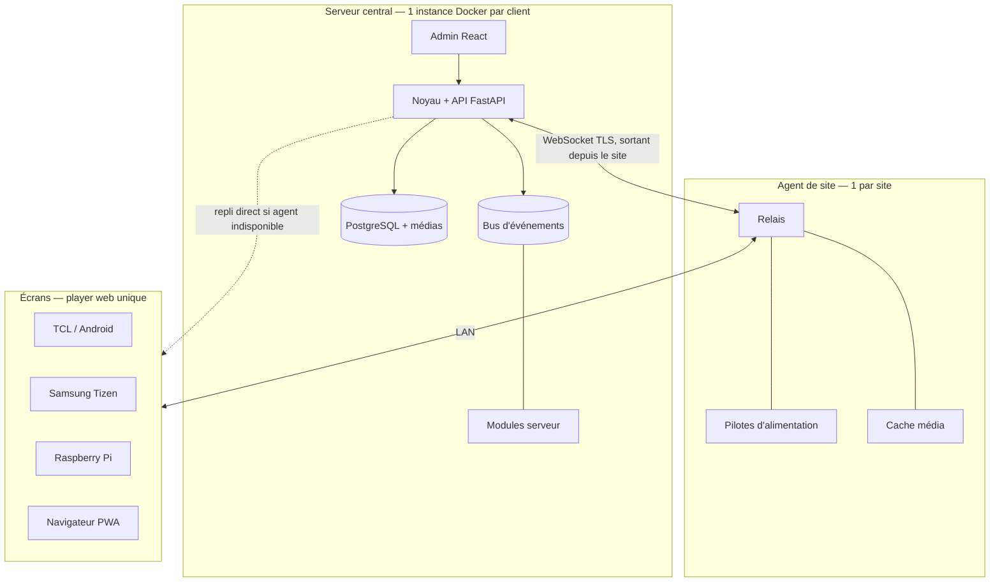

# VDS — Architecture

## Contraintes

| Contrainte | Valeur | Effet |
| --- | --- | --- |
| Déploiement | Autonome (une instance Docker par client) OU hébergé dans le Studio Allia (Dokploy, `/espace/affichage`) | Même code ; le mode = un préréglage de modules |
| Multi-locataire | Plusieurs sites par instance, un client par instance | Pas de multi-locataire |
| Volume | 4 sites à 1 an, illimité ensuite | Installation et mise à jour en une commande |
| Équipe | 1 développeur | Peu de pièces mobiles |
| Matériel | TCL Google TV 2023, Samsung Tizen grand public 2023, Raspberry Pi, navigateurs | Un player web, 4 empaquetages |
| Exposition | Écrans accessibles au public | Kiosque obligatoire |
| Réseaux | Agent local autorisé sur chaque site | Un agent par site |
| Hors service | Ex. 18h30 → 8h30 | Autonomie hors ligne ≥ 1 journée |

## Vue d'ensemble



## Deux modes de déploiement

| | Autonome | Hébergé Studio Allia |
| --- | --- | --- |
| Lancement | `docker compose up` | Application Dokploy `vds` (VPS 1), image construite en CI |
| `VDS_BASE_PATH` | `/` | `/espace/affichage` |
| `VDS_AUTH_PROVIDER` | `auth.local` | `auth.studio-allia` |
| `VDS_THEME` | `theme.vtech` | `theme.allia` |
| Base | PostgreSQL de l'instance | `vds-db` (postgres:17), séparée de `espace-db` |

Détail complet : `docs/integration-studio-allia.md`.

Conséquences techniques :
- **Chemin de base partout** : routes FastAPI montées sous `VDS_BASE_PATH`, admin React construite avec une base relative et une config d'exécution (`<base>/config.js` servi par le serveur), WebSocket et médias sous le même préfixe.
- **Auth abstraite dès le lot 1** : l'interface `auth-provider` n'est plus un module futur, elle porte `auth.local` et `auth.studio-allia`. SSO génériques (LDAP, M365, Google) restent futurs.
- **Thème = module** (`kind: theme`) : jeu de tokens CSS, polices, logo, ton éditorial. L'admin et les écrans système du player chargent le thème actif.

## Noyau

Responsabilités :
- API REST + WebSocket (OpenAPI générée)
- Registre des modules : chargement, versions, dépendances, état, quarantaine
- Bus d'événements interne (pub/sub typé, persistant pour les événements critiques)
- Résolution de la configuration héritée + provenance
- Utilisateurs, rôles (admin, éditeur), pipeline d'authentification délégué au module `auth-provider` actif (la connexion locale est le module `auth.local`, pas du code noyau — décision lot 1), groupes, validation avant diffusion
- Planification et résolution de la diffusion par écran

Version du noyau = version du contrat de module : **`vds-core 1.0.0`** au lot 1 (`vds_sdk.CORE_API_VERSION`). Toute évolution du contrat = bump + note de compatibilité dans `docs/roadmap.md` › Décisions.

## Monorepo (décision lot 1)

Un dépôt, deux espaces de travail : **uv workspace** (Python 3.12) à la racine et **pnpm workspace** (Node 22 LTS, pnpm via corepack, champ `packageManager`).

```
Makefile                  # dev test lint e2e api-types migrate i18n-check fmt
pyproject.toml            # [tool.uv.workspace] members = apps/server, apps/site-agent, packages/sdk-py ; config ruff + mypy (strict) + pytest
uv.lock  .python-version  # 3.12
package.json  pnpm-workspace.yaml  pnpm-lock.yaml  tsconfig.base.json
.env.example              # toutes les variables VDS_*, aucune valeur secrète
apps/server/              # paquet vds_server
  pyproject.toml  alembic.ini
  src/vds_server/
    main.py               # create_app(settings) -> ASGI app (montée sous VDS_BASE_PATH)
    settings.py           # pydantic-settings, préfixe VDS_
    http/                 # base_path.py, security_headers.py, same_origin.py, spa.py (admin + player + config.js)
    db/                   # base.py, session.py (asyncpg), models/
    core/                 # registry.py, bus.py, outbox.py, config_resolver.py, auth.py, audit.py
    api/v1/               # health, me, auth, sites, groups, screens, config, modules
  migrations/             # env.py + versions/0001_socle.py (branche "core")
  tests/
apps/site-agent/          # paquet vds_agent : squelette seul au lot 1 (pyproject + __main__), code au lot 3
apps/admin/               # React 18 + Vite, base "./" ; eslint.config.js (la config ESLint vit ici, pas à la racine) ; src/runtime-config.ts, src/theme/, src/i18n/{fr,en}.json
apps/player/              # squelette Vite au lot 1 (servi sous <base>/player/), code au lot 2
packages/sdk-py/          # paquet vds_sdk : contrat de module (voir plus bas)
packages/sdk-ts/          # api.gen.ts (openapi-typescript), runtime-config.ts, content-type.ts (interface, lot 2)
modules/<id>/             # format du skill vds-module ; au lot 1 : auth.local, theme.vtech, theme.allia
                          # (auth.studio-allia au lot 4 bis). Les modules ne sont PAS des membres du workspace :
                          # le noyau les charge par chemin ; leurs dépendances Python vivent dans apps/server.
docker/
  server.Dockerfile       # multi-étapes : pnpm build admin + player -> image Python unique (API + statiques)
  site-agent.Dockerfile
  compose.yaml            # postgres:17 + server (mode autonome, VDS_BASE_PATH=/)
  compose.dev.yaml        # surcharges dev (rechargement, vite)
  compose.subpath.yaml    # surcharge VDS_BASE_PATH=/espace/affichage pour les tests
deploy/dokploy/README.md  # application vds, variables, routage, sauvegardes — sans secret
.github/workflows/
  ci.yml                  # lint + test (matrice VDS_BASE_PATH = / et /espace/affichage) + e2e
  images.yml              # build + push vds-server et vds-site-agent (registre : question ouverte, GHCR proposé)
```

- **Une seule image serveur** (API + admin + player statiques, un port) : colle à l'application Dokploy unique `vds` et à `docker compose up`. Pas de nginx séparé.
- Tests serveur sur un **vrai PostgreSQL 17** (service compose `db-test`) : le schéma utilise jsonb, colonnes générées, citext. Pas de SQLite.
- `make api-types` : export OpenAPI (`python -m vds_server.openapi`) → `openapi-typescript` → `packages/sdk-ts/src/api.gen.ts`, versionné ; la CI échoue si le fichier diffère.
- `make test` = pytest (deux valeurs de `VDS_BASE_PATH`) + vitest + `pnpm i18n:check`.

## Contrat de module

Manifeste (`module.json`), schéma de validation livré dans `packages/sdk-py/src/vds_sdk/schemas/module.schema.json` (JSON Schema 2020-12) :

```json
{
  "id": "power.samsung-ws",
  "version": "1.2.0",
  "core": ">=1.0 <2.0",
  "kind": "power-driver",
  "name": { "fr": "...", "en": "..." },
  "description": { "fr": "...", "en": "..." },
  "targets": ["server", "site-agent"],
  "entrypoints": { "server": "server.module:SamsungWsDriver", "site-agent": "agent.module:SamsungWsDriver" },
  "requires": {},
  "capabilities": ["power.on", "power.off", "power.state"],
  "permissions": ["lan.access", "screens.read"],
  "events": { "listens": ["power.requested"], "emits": ["power.changed"] },
  "config": { "$ref": "config.schema.json" },
  "assets": "assets",
  "i18n": ["fr", "en"],
  "author": "V-Tech",
  "signature": null
}
```

Champs (contrat 1.0) :

| Champ | Règle |
| --- | --- |
| `id` | `^[a-z][a-z0-9]*\.[a-z0-9][a-z0-9-]*$` (`<kind-court>.<nom>`), immuable |
| `version`, `core` | semver ; `core` = intervalle de `vds-core` compatible, vérifié au chargement |
| `kind` | `player-adapter` · `power-driver` · `content-type` · `trigger` · `notifier` · `auth-provider` · `theme` · `storage` (liste fermée en 1.x) |
| `targets` | sous-ensemble de `server`, `site-agent`, `admin`, `player` |
| `entrypoints` | `"<chemin.module.python>:<Classe>"` relatif au dossier du module, par cible Python ; absent pour un module déclaratif (`theme`) |
| `requires` | `{ "<id>": "<intervalle semver>" }` : ordre d'activation uniquement, jamais d'appel direct |
| `events.listens` / `events.emits` | noms `domaine.verbe_passé`, suffixe optionnel `@N` (version de payload, défaut 1). Le noyau refuse à l'exécution toute publication ou abonnement non déclaré |
| `permissions` | catalogue fermé ci-dessous ; refus à l'exécution hors déclaration |
| `assets` | dossier servi en lecture seule sous `<base>/modules/<id>/assets/` |
| `theme` | obligatoire si `kind = theme` : `{ "css": "assets/tokens.css", "fonts": [...], "logo": {"light": "...", "dark": "..."}, "icons": "material-symbols" \| "lucide", "color_schemes": ["light","dark"] }` |
| `signature` | `null` pour les modules intégrés ; tiers non signés bloqués par défaut |

Schéma de config (`config.schema.json`, JSON Schema 2020-12, `type: object`, `additionalProperties: false`). Chaque propriété de premier niveau porte obligatoirement `title`, `description` (clés i18n), `default` (sauf si listée dans `required`) et `x-vds-level: "simple" | "advanced"`. Extensions optionnelles :
- `x-vds-scopes` : niveaux autorisés à surcharger (`organization`, `site`, `group`, `screen`) ; défaut : les quatre.
- `x-vds-env` : nom d'une variable d'environnement qui fournit la valeur (ex. `STUDIO_SESSION_URL`) ; la clé devient non modifiable par l'API.
- `x-vds-secret: true` : jamais renvoyée par l'API HTTP ni journalisée (implique `x-vds-env`). L'API renvoie `value: null` + `is_set: bool` + provenance `env`. Le **module propriétaire** la reçoit via `ctx.config.resolve()` sous forme de `pydantic.SecretStr` (lecture par `get_secret_value()`, `repr` masqué) ; aucun autre module n'y a accès.
- `x-vds-groups` (racine) : regroupement des champs dans le formulaire.

Permissions (catalogue 1.0) : `screens.read`, `screens.write`, `sites.read`, `config.read.core`, `users.read`, `media.read`, `media.write`, `lan.access`, `net.outbound`, `fs.media`, `http.routes`, `db.own-tables`, `users.provision`. `users.provision` (façade `ctx.core.users.provision(identity: Identity, *, role: Literal["admin","editor"] | None = None) -> UserRef`, upsert par `(provider, external_id)`) n'est acceptée que si `kind = "auth-provider"` : le registre rejette tout autre manifeste qui la déclare. Un module lit toujours sa propre config. En processus (modules intégrés), les permissions sont appliquées par la façade `CoreApi` ; l'isolation forte ne concerne que les modules tiers (processus séparé).

Interfaces Python (`vds_sdk`, sans dépendance FastAPI ; les kinds serveur sont dans `vds_sdk.server`) :

```python
CORE_API_VERSION = "1.0.0"


class ModuleContext(Protocol):
    module_id: str
    bus: ScopedBus  # filtré par events.listens/emits
    config: ConfigReader  # async resolve(scope: ScopeRef | None = None) -> dict[str, Any]
    core: CoreApi  # façade filtrée par permissions
    log: logging.Logger

    def t(self, key: str, locale: str, **params: Any) -> str: ...


class Module(ABC):
    async def setup(self, ctx: ModuleContext) -> None: ...
    async def teardown(self) -> None: ...
    async def health(self) -> Health: ...  # défaut : ok
    def routes(
        self,
    ) -> "APIRouter | None": ...  # permission http.routes ; monté sous <base>/api/v1/m/<id>/


class Identity(BaseModel):  # renvoyé par un auth-provider
    provider: str
    external_id: str
    email: str | None
    display_name: str
    role: Literal["admin", "editor"] | None  # None = rôle géré dans VDS (auth.local)


class AuthProvider(Module):
    async def authenticate(
        self, request: AuthRequest
    ) -> Identity | None: ...  # lève AccessDenied(code) pour refuser (ex. financeur)
    def login_url(self, return_to: str) -> str: ...
    def logout_url(self) -> str: ...
    def shell_links(self) -> list[ShellLink]: ...  # ex. « Retour au Studio » ; défaut []
```

Le noyau transforme l'`Identity` en `Principal` (upsert `user_account` par `(provider, external_id)`), puis applique rôles et contrôle de même origine. Rôles V1 : `admin` (écriture) et `editor` (lecture du parc et de la config, contenus) ; pas de lecteur (ajout futur = valeur `CHECK` additive + bump mineur). Un `Identity.role` non `None` fait foi à chaque connexion ; un auth-provider qui reçoit un rôle externe inconnu lève `AccessDenied("role_unmapped")` (refus par défaut). La validation avant diffusion est un droit par groupe, pas un rôle. Limitation de débit des connexions : responsabilité du module auth qui porte le formulaire (`auth.local` : table `m_auth_local_login_attempt`, 5 échecs / 15 min par identifiant normalisé et 20 / 15 min par IP, 429 `errors.auth.too_many_attempts` + `Retry-After`) ; le noyau fournit seulement `ctx.core.http.client_ip(request) -> str`, résolue avec la même règle de proxy de confiance que le contrôle de même origine. Un seul auth-provider actif (`VDS_AUTH_PROVIDER`), un seul thème actif (`VDS_THEME`). Le kind `theme` est **déclaratif** (manifeste + assets, aucun code). Les classes de base des autres kinds (`PowerDriver`, `Notifier`, `Trigger`, `Storage`, `PlayerAdapter`, et `ContentType` côté `sdk-ts`) sont ajoutées dans leur lot ; la liste des kinds est déjà figée.

Bus d'événements :

```python
class Event(BaseModel):  # payload ; une classe par (nom, version)
    name: ClassVar[str]  # "config.changed"
    version: ClassVar[int] = 1
    critical: ClassVar[bool] = False  # True -> persisté (outbox) et livré au moins une fois


class Envelope(BaseModel):
    id: UUID
    name: str
    version: int
    occurred_at: datetime
    source: str  # "core" ou id de module
    origin: str = "server"  # point d'accroche du pont agent (lot 3) : "agent:<site_id>"
    correlation_id: UUID | None
    payload: dict[str, Any]


class ScopedBus(Protocol):
    async def publish(self, event: Event, *, correlation_id: UUID | None = None) -> UUID: ...
    def subscribe(
        self, event_type: type[Event], handler: Callable[[Envelope], Awaitable[None]]
    ) -> None: ...
```

- Événements des domaines partagés (`core`, `module`, `config`, `screen`, `site`, `power`, `content`, `alert`…) : modèles Pydantic dans `vds_sdk.events`, exportés en JSON Schema. Un module ne crée de nouveaux noms que sous son propre id.
- Payload : ajout de champ optionnel = même version ; tout autre changement = version N+1, les deux publiées pendant la transition.
- Abonnés idempotents (clé = `Envelope.id`). Échecs d'un abonné : 5 en 10 min (réglage `core`) → module en quarantaine + `module.quarantined`.
- Événements noyau du lot 1 : `module.enabled`, `module.disabled`, `module.quarantined` (critique), `config.changed`, `site.created|updated|deleted`, `group.*`, `screen.*` (mêmes verbes), `user.created`.

Cycle de vie (lot 1) : au démarrage, le registre découvre `modules/*/module.json`, valide manifeste + schéma de config + compatibilité `core`, synchronise la table `module`, active les modules requis (`VDS_AUTH_PROVIDER`, `VDS_THEME`) puis les autres activés en base. Activer / désactiver / quarantaine fonctionnent à chaud. Installation d'archive, mise à jour et rollback : même format, livrés plus tard (risque « modularité trop lourde »).

Tables propres à un module intégré (permission `db.own-tables`) : préfixe `m_<id avec . et - remplacés par _>_` (ex. `m_auth_local_session`), migrations dans `modules/<id>/server/migrations/`, branche Alembic = id du module, clés étrangères autorisées **uniquement** vers les tables du noyau. Les modules tiers n'ont pas d'accès base.

- L'admin génère les formulaires depuis le schéma de config (`x-vds-level` décide simple / avancé).
- Cycle de vie cible : installer → valider permissions → activer → mettre à jour → rollback → désactiver, sans redémarrage. Échecs répétés → quarantaine.
- Modules tiers : processus/conteneur isolé côté serveur, iframe sandbox côté player, signature (non signés bloqués par défaut), compatibilité semver vérifiée à l'installation.

## Chemin de base `VDS_BASE_PATH` (décision lot 1)

Normalisation au démarrage (`settings.py`) : `/` → `""`, sinon `^(/[a-z0-9_-]+)+$` sans `/` final (`/espace/affichage`). Toute autre valeur fait échouer le démarrage. Aucune autre variable ne dépend du mode.

| Élément | URL | Règle |
| --- | --- | --- |
| Montage | `Mount(base, app=vds_app)` | Toujours la même construction, quelle que soit la valeur ; hors du préfixe : 404. Le préfixe n'est jamais retiré par le proxy |
| API | `<base>/api/v1/...` ; modules : `<base>/api/v1/m/<id>/...` | OpenAPI et docs sous le même préfixe |

Note : les routes de module (`/api/v1/m/<id>/`) sont montées dynamiquement et ne figurent **pas** dans l'OpenAPI principale ni dans `packages/sdk-ts` (`make api-types`, `make api-types-check` en CI ; export sans DB par `scripts/export_openapi.py`).
| Santé | `<base>/health` | Moniteur Uptime Kuma |
| WebSocket | `<base>/ws/player`, `<base>/ws/agent`, `<base>/ws/admin` | Players et agents stockent l'**URL complète du serveur, préfixe compris**, et y ajoutent des chemins relatifs |
| Admin | `<base>/` (repli SPA sur `index.html` hors `api/ws/media/modules/player/health`) | Vite `base: "./"` ; le serveur injecte `<base href="<base>/">` dans `index.html` au démarrage ; React Router `basename` lu dans la config d'exécution |
| Config d'exécution | `<base>/config.js` (no-store) | `window.__VDS__ = { basePath, apiBase, wsBase, defaultLocale, version, theme: {id, cssUrl, icons, logo}, auth: {provider, loginUrl, logoutUrl, links} }` — fichier, pas de script en ligne (CSP) |
| Player | `<base>/player/` | Service Worker de portée `<base>/player/` |
| Médias | `<base>/media/<media_id>/<variant>` | La base ne stocke **que des clés relatives**, jamais d'URL absolue ; les URL sont construites par `url_for` / `settings.url()` |
| Assets de module | `<base>/modules/<id>/assets/...` | Thèmes, web components |
| Cookies | `Path=<base>/` (ou `/`), `HttpOnly; Secure; SameSite=Lax` | Posés uniquement par le module auth actif via `ctx.core.http.cookie_path()` |
| Redirections | `settings.url("/...")` | Paramètre `return_to` accepté seulement s'il est un chemin commençant par `<base>/` (pas de `//`, pas de schéma) ; l'URL de connexion vient de `AuthProvider.login_url()` |

- **Contrôle de même origine** (les deux modes) : toute méthode non sûre sous `<base>/api/` sans `Authorization: Bearer` exige `Sec-Fetch-Site: same-origin` ou un `Origin` égal à `VDS_PUBLIC_ORIGIN` (à défaut, l'origine reconstruite derrière proxy de confiance). Sinon 403 `errors.origin_mismatch`.
- **En-têtes** (les deux modes, aucune branche) : `X-Robots-Tag: noindex`, `X-Frame-Options: DENY`, `Cache-Control: private, no-store` sur tout le préfixe ; le player et l'agent font leur propre cache.
- Ce qui varie selon le déploiement passe par : `VDS_BASE_PATH`, `VDS_AUTH_PROVIDER`, `VDS_THEME`, `VDS_DEFAULT_LOCALE`, `VDS_PUBLIC_ORIGIN`, et les clés `x-vds-env` des modules (`STUDIO_SESSION_URL`, `STUDIO_SHARED_SECRET` appartiennent à `auth.studio-allia` ; `VDS_ADMIN_EMAIL`, `VDS_ADMIN_PASSWORD` appartiennent à `auth.local` : premier admin créé au démarrage si aucun compte n'existe, sans jeton d'amorçage). Autres variables : `VDS_DATABASE_URL`, `VDS_SECRET_KEY`, `VDS_MEDIA_DIR`, `VDS_MODULES_DIR`.
- Tests : fixture pytest paramétrée sur `/` et `/espace/affichage` pour toute la suite API ; Playwright lancé sur les deux (surcharge `docker/compose.subpath.yaml`) ; matrice CI.

## Modèle de données initial (migration `0001_socle`, PostgreSQL 17)

Conventions : clés `uuid` par `gen_random_uuid()`, horodatages `timestamptz`, `created_at`/`updated_at` partout, extension `citext`, énumérations en `text` + `CHECK` (plus simples à étendre de façon additive qu'un `ENUM`), migrations additives.

| Table | Colonnes clés | Contraintes / index |
| --- | --- | --- |
| `organization` | id, name, singleton bool | `singleton` `UNIQUE` + `CHECK (singleton)` : une seule ligne (un client par instance) |
| `site` | id, organization_id, name, slug, archived_at | FK organization ; `UNIQUE (slug)` |
| `screen_group` | id, site_id, name | FK site `ON DELETE RESTRICT` ; `UNIQUE (site_id, name)` ; `UNIQUE (id, site_id)` (cible de FK composite) |
| `screen` | id, site_id, group_id null, name, orientation (`landscape`/`portrait`), archived_at | FK site ; FK composite `(group_id, site_id) → screen_group(id, site_id)` : le groupe est forcément du même site ; index `(site_id)`, `(group_id)` |
| `user_account` | id, auth_provider, external_id, email citext null, display_name, role (`admin`/`editor`), locale null, is_active, last_seen_at | `UNIQUE (auth_provider, external_id)` ; index `(email)` non unique |
| `config_override` | id, organization_id / site_id / group_id / screen_id (nullables), scope_level (généré : 0 org, 1 site, 2 groupe, 3 écran), scope_id (généré : `COALESCE(screen_id, group_id, site_id, organization_id)`), namespace, key, value jsonb, updated_by | `CHECK (num_nonnulls(organization_id, site_id, group_id, screen_id) = 1)` ; FK `ON DELETE CASCADE` ; `UNIQUE (scope_id, namespace, key)` ; index `(namespace, key)` (« qui surcharge X ? ») |
| `module` | id text PK, version, kind, source (`builtin`/`installed`), state (`discovered`/`enabled`/`disabled`/`quarantined`/`incompatible`), manifest jsonb, config_schema jsonb, checksum, failure_count, last_error, state_changed_at | `CHECK` sur kind et state |
| `event_outbox` | id uuid, name, version, source, origin, correlation_id, payload jsonb, occurred_at | index `(occurred_at)` ; uniquement les événements `critical` |
| `event_delivery` | event_id, subscriber, status (`pending`/`done`/`failed`), attempts, next_attempt_at, last_error | PK `(event_id, subscriber)` ; index partiel `(next_attempt_at) WHERE status = 'pending'` |
| `audit_log` | id bigserial, occurred_at, actor_kind (`user`/`module`/`system`/`device`), actor_id, action, target_type, target_id, details jsonb | index `(target_type, target_id)`, `(occurred_at)` |

Module `auth.local` (branche Alembic `auth.local`) : `m_auth_local_credential(user_id PK→user_account, password_hash argon2id, must_change)`, `m_auth_local_session(id, user_id, token_hash UNIQUE, expires_at, revoked_at, last_seen_at)`.

Ajouts prévus (additifs, lots suivants) : jetons d'appareil, médias, playlists, programmation (lot 2, migration `0002_diffusion`, voir « Diffusion et player »), `tag` + `screen_tag` (ciblage transversal, reporté au lot 4), `site_agent` (lot 3), groupes d'utilisateurs / validation (lot 4). Points d'accroche réservés : position dans un mur (colonnes futures sur `screen`), `conditions` sur `schedule`, clés d'API (`Authorization: Bearer` déjà exempté du contrôle d'origine).

## Configuration héritée — résolution

- **Espaces de noms** : `core` (schéma livré par le serveur : `timezone` défaut `Europe/Paris`, `locale`, réglages de quarantaine…) et un par module (son `config.schema.json`). Les variables d'environnement de déploiement ne sont jamais en base.
- **Granularité** : clé de premier niveau. Objets et tableaux sont remplacés en bloc (pas de fusion profonde).
- **Algorithme** `resolve(namespace, target)` : chaîne `[organisation, site, groupe?, écran]` de la cible ; une requête `WHERE namespace = :ns AND scope_id = ANY(:chain)` ; on part des `default` du schéma (provenance `default`), puis on applique les surcharges par `scope_level` croissant ; les clés `x-vds-env` sont lues dans l'environnement (provenance `env`). Une valeur stockée devenue invalide pour le schéma courant est ignorée et signalée (`warnings`).
- **Écriture** : refusée si le niveau n'est pas dans `x-vds-scopes` ou si la valeur ne valide pas ; publie `config.changed {namespace, keys, scope_level, scope_id}` qui invalide le cache mémoire du résolveur.
- **API** :
  - `GET <base>/api/v1/config/{level}/{id}/{namespace}` → `{ "values": { "<clé>": { "value": …, "origin": { "level": "site", "id": "…", "name": "Moulins" } | { "level": "default" } | { "level": "env" }, "inherited": …, "overridable": true } }, "warnings": [] }` (`inherited` = valeur sans la surcharge de ce niveau, pour « revenir à l'héritage »).
  - `PUT …/{namespace}/{key}` `{ "value": … }` ; `DELETE …/{namespace}/{key}` = revenir à l'héritage.

| kind | Rôle | V1 |
| --- | --- | --- |
| player-adapter | Installation, capture, redémarrage, kiosque | Android, Tizen, Chromium Pi |
| power-driver | Allumer / éteindre / lire l'état | ADB, Samsung WS, WoL, CEC, écran noir |
| content-type | Rendu d'un contenu (web component) | image, vidéo, PDF, URL, météo, RSS |
| trigger | Source d'événements | planning |
| notifier | Notifications | mail |
| auth-provider | Identité | local, studio-allia |
| theme | Tokens, polices, logo, ton | vtech, allia |
| storage | Médias | disque local |

## Players

| Plateforme | Empaquetage | Kiosque | Pilotage local |
| --- | --- | --- | --- |
| TCL Google TV | App Android (WebView) sur la TV | Device Owner / épinglage, boot | ADB réseau, CEC |
| Clé Android TV | Même app | Idem | ADB, CEC selon modèle |
| Samsung Tizen | App web Tizen (mode dev) ou boîtier HDMI | Lancement auto, touches neutralisées | API WebSocket Samsung, WoL |
| Raspberry Pi | Chromium kiosque, image dédiée | Pas de bureau | CEC (libcec) |
| Navigateur | PWA plein écran | Limité | WoL, veille OS |

Player : appairage par code, sync WebSocket (repli polling), cache journée + lendemain, lecture hors ligne (rallumage inclus), remontée d'état, captures à la demande, watchdog. Kiosque : pas de sortie, reprise après coupure, télécommande/USB neutralisés si possible, déverrouillage maintenance par code depuis l'admin.

## Alimentation — pilotes en cascade

Exécutés sur l'agent de site. Ordre par défaut, modifiable par écran :

| # | Pilote | On | Off | État | V1 |
| --- | --- | --- | --- | --- | --- |
| 1 | API constructeur (Samsung WS, ADB) | partiel | oui | oui | oui |
| 2 | Wake-on-LAN | oui | non | non | oui |
| 3 | HDMI-CEC via player | oui | oui | oui | oui |
| 4 | Cloud constructeur | oui | oui | oui | futur |
| 5 | Infrarouge | oui | oui | non | futur |
| 6 | Prise connectée | oui | oui | oui | futur |
| 7 | Écran noir | simulé | simulé | oui | toujours |

Règles : assistant de détection à l'ajout ; vérification après chaque ordre, retry puis pilote suivant ; CEC Active Source au rallumage ; gestion veille auto TV / « aucun signal » / mauvaise entrée. Planning : plages par jour, exceptions (fériés, vacances scolaires par zone, fermetures). Supervision : `scheduled_off` ≠ `offline`, aucune alerte en plage prévue.

## Contenus et diffusion

| Objet | Contenu |
| --- | --- |
| Media | image, vidéo ≤ 4K (son on/off), PDF → pages, URL |
| Widget | météo, RSS (content-type) |
| Layout | grille de zones + calques (bandeau, logo, horloge) ; paysage et portrait |
| Playlist | éléments + durées + transitions, affectée à une zone |
| Schedule | layout + playlists + créneau + cible (site/groupe/tag/écran) |
| Override | layout prioritaire sur un créneau |

Résolution par écran : override actif > alternance des schedules actifs > hors plage = éteint (ou écran noir). Le serveur calcule ; le player reçoit le résultat pour J et J+1.

## Diffusion et player (décision lot 2, vds-core 1.1.0)

Jalon : un écran TCL réel joue une playlist. Tout ce qui suit est identique dans les deux modes ; toutes les URL échangées avec le player sont **relatives à l'URL serveur stockée par l'appareil** (préfixe compris), jamais absolues. Tests d'API et Playwright paramétrés sur `VDS_BASE_PATH=/` et `/espace/affichage`.

### Compatibilité vds-core 1.1.0 (mineure, additive)

- Manifeste : bloc `content` obligatoire si `kind = content-type` (voir ci-dessous). Un module 1.0 reste valide ; un module content-type déclare `"core": ">=1.1 <2.0"`.
- `vds_sdk.server` : interfaces `ContentType` et `StorageBackend` ; façade `ctx.core.media` (permissions existantes `media.read` / `media.write`, aucune nouvelle permission).
- `vds_sdk.events` : domaines `media`, `playlist`, `schedule` ; verbes `screen.paired`, `screen.unpaired`.
- `packages/sdk-ts` : `content.ts` (contrat web component, `CONTENT_API_VERSION = 1`) et `player.ts` (format de programmation résolue, `SCHEDULE_FORMAT = 1`).

### Appairage et jeton d'appareil

1. Player non appairé : `POST <base>/api/v1/player/pairings` `{ device: { platform, model, app_version, user_agent, screen_w, screen_h } }` (sans auth, limité par IP via `ctx.core.http.client_ip()`) → `201 { pairing_id, code, poll_secret, expires_at, poll_interval_s: 3 }`. `code` = 6 caractères Crockford base32 sans ambiguïté, affiché `ABC-234` ; validité 15 min ; seul un admin connecté peut l'utiliser, il n'est donc pas secret vis-à-vis du public.
2. Admin : `POST <base>/api/v1/pairings/claim` `{ code, screen_id }` (cookie + contrôle de même origine, rôle admin) → `200 { screen_id }`. L'écran est créé avant dans l'admin (même parcours).
3. Player : `GET <base>/api/v1/player/pairings/{pairing_id}` avec `Authorization: Bearer <poll_secret>` → `202` en attente · `200 { device_token, screen_id, server_time }` **une seule fois** (le jeton est généré à cet instant, seul son hash est stocké ; aucun jeton en clair en base) · `410` expiré ou déjà consommé.
4. Jeton d'appareil : `vds_dev_<32 octets base64url>`, opaque, stocké en `sha256`. Toutes les routes `/api/v1/player/*` et `<base>/media/*` l'acceptent en `Authorization: Bearer` (donc exemptées du contrôle d'origine). Le préfixe `vds_dev_` réserve `vds_key_` aux futures clés d'API publique.
5. Révocation : `DELETE <base>/api/v1/screens/{id}/device` (admin) → `revoked_at`, audit, `screen.unpaired {screen_id, reason: "revoked"}`. Un nouvel appairage révoque l'ancien jeton (un seul appareil actif par écran, `reason: "replaced"`). Le player qui reçoit `401 errors.device_revoked` efface jeton, programmation et cache média, puis revient à l'écran d'appairage. Toute autre erreur (réseau, 5xx) = poursuite hors ligne. Pas d'expiration ni de rotation en V1 (`expires_at` nullable réservé).
6. Événements : `screen.paired {screen_id, device_id, platform}`, `screen.unpaired {screen_id, device_id, reason}`. Le heartbeat n'est **pas** publié sur le bus (bruit) ; il met à jour `screen_device.last_seen_at` (la supervision du lot 3 en dérivera `screen.status_changed`).

### Synchronisation (lot 2 : polling, pas de `/ws`)

- `POST <base>/api/v1/player/heartbeat` toutes les 60 s (`core.player.poll_interval_s`) : `{ revision, playing: {item_id, since} | null, cache: {bytes, quota, missing: [asset_key]}, app_version, uptime_s, stale: bool, errors: [{at, code, item_id?}] }` → `200 { revision, server_time, poll_interval_s, commands: [] }`. Si `revision` diffère de la sienne, le player recharge la programmation. `commands` est le point d'accroche des actions à distance (capture, rechargement), vide en lot 2.
- `/ws/player` est **reporté au lot 3**, livré avec `/ws/agent` (même enveloppe de messages, diffusion multi-workers par `LISTEN/NOTIFY`). Le polling reste le repli permanent prévu par l'architecture ; seul le délai de propagation (≤ 60 s) change.

### Programmation résolue servie au player

`GET <base>/api/v1/player/schedule?format=1` (Bearer) → `ETag: "<revision>"`, `If-None-Match` → `304`. Le serveur sert le format demandé et le précédent ; ajout de champ optionnel = même format, tout autre changement = `format` N+1.

```json
{
  "format": 1,
  "revision": "sha256:…",
  "server_time": "2026-10-23T14:02:11Z",
  "screen": { "id": "…", "name": "Accueil", "orientation": "landscape" },
  "timezone": "Europe/Paris",
  "valid_from": "2026-10-23T00:00:00+02:00",
  "valid_until": "2026-10-25T00:00:00+02:00",
  "slots": [
    { "start": "2026-10-23T00:00:00+02:00", "end": "2026-10-23T08:00:00+02:00", "kind": "off", "mode": "black" },
    { "start": "2026-10-23T08:00:00+02:00", "end": "2026-10-23T19:00:00+02:00", "kind": "play",
      "layout": { "zones": [ { "id": "main", "x": 0, "y": 0, "w": 1, "h": 1, "playlist": "pl_…" } ] },
      "source": { "schedule_id": "…" } }
  ],
  "playlists": {
    "pl_…": { "items": [
      { "id": "it_…", "content_type": "content.image", "duration_ms": 10000,
        "props": { "src": "media/<media_id>/original" }, "assets": ["media/<media_id>/original"], "requires_network": false }
    ] }
  },
  "assets": { "media/<media_id>/original": { "sha256": "…", "bytes": 123456, "mime": "image/jpeg" } },
  "content_types": { "content.image": { "version": "1.0.0", "element": "vds-content-image", "script": "modules/content.image/assets/player.js" } }
}
```

- `slots` couvrent `[valid_from, valid_until)` sans trou, en instants absolus avec décalage (changement d'heure calculé côté serveur). Le player corrige sa dérive d'horloge avec `server_time`.
- `revision` = sha256 du JSON canonique hors `server_time` : stable tant que rien ne change.
- Lot 2 : un seul layout implicite plein écran (zone `main`) ; la forme `zones` est déjà celle de la grille du lot 4 (calques = zones supplémentaires). Créneau `off` = écran noir côté player (les pilotes d'alimentation arrivent au lot 3, ils liront les mêmes créneaux).
- Au-delà de `valid_until` sans réseau, le player rejoue le motif de J+1 décalé de jours entiers (mêmes heures locales) et signale `stale: true`.
- Résolution lot 2 (fonction pure `vds_server.diffusion.resolver.resolve(target_chain, schedules, tz, day) -> list[Slot]`) : parmi les schedules actifs à l'instant, cible la plus spécifique (écran > groupe > site > organisation), puis `priority` décroissante, puis `updated_at` le plus récent. Aucun actif = `off`. Alternance et override : lot 4, insérés dans la même fonction.

### Modèle de données (migration `0002_diffusion`, noyau)

| Table | Colonnes clés | Contraintes |
| --- | --- | --- |
| `screen_device` | id, screen_id, token_hash, platform, model, app_version, paired_at, paired_by, last_seen_at, last_heartbeat jsonb, expires_at null, revoked_at, revoked_by | `UNIQUE (token_hash)` ; index unique partiel `(screen_id) WHERE revoked_at IS NULL` |
| `pairing_request` | id, code citext, poll_secret_hash, device jsonb, status (`pending`/`claimed`/`consumed`/`expired`), screen_id null, claimed_by, expires_at | index unique partiel `(code) WHERE status = 'pending'` ; purge des lignes expirées |
| `media` | id, kind (`image`/`video`/`document`), title, original_filename, mime, bytes, sha256, width, height, duration_ms, page_count, storage_backend, storage_key (relatif), status (`processing`/`ready`/`failed`), error, created_by | index `(sha256)` (dédoublonnage proposé à l'envoi) |
| `media_variant` | media_id, name (`original`, `page-<n>`, `poster`, `thumb`), mime, bytes, sha256, width, height, storage_key | PK `(media_id, name)` ; FK `ON DELETE CASCADE` |
| `playlist` | id, name, description, created_by, updated_by | — |
| `playlist_item` | id, playlist_id, position, content_type (id de module), props jsonb, duration_ms null, enabled | FK `ON DELETE CASCADE` ; `UNIQUE (playlist_id, position) DEFERRABLE` |
| `playlist_item_media` | item_id, media_id | PK des deux ; FK média `ON DELETE RESTRICT` (un média utilisé ne se supprime pas) ; extrait par le noyau des props marquées `x-vds-media` |
| `schedule` | id, name, playlist_id, target_type (`organization`/`site`/`group`/`screen`), target_id, priority int, starts_on date null, ends_on date null, enabled, conditions jsonb null | `CHECK` sur target_type (extensible : `tag` au lot 4) ; `conditions` = point d'accroche, ignoré en V1 ; `layout_id` ajouté au lot 4 |
| `schedule_rule` | id, schedule_id, weekdays smallint (masque lundi = 1), start_minute smallint, end_minute smallint (minutes depuis minuit, API en `HH:MM`) | `CHECK (0 <= start_minute < end_minute <= 1440)` (`24:00` = 1440, non représentable en `time` côté Python) ; pas de créneau qui passe minuit en V1 (deux règles) |

Événements (domaines partagés, `vds_sdk.events`) : `media.uploaded {media_id, kind, mime}`, `media.ready {media_id}`, `media.failed {media_id, code}`, `media.deleted`, `playlist.created|updated|deleted {playlist_id}`, `schedule.created|updated|deleted {schedule_id}`. Aucun n'est critique en lot 2.

### Stockage des médias

- Octets : module `storage.local` (kind `storage`), racine `VDS_MEDIA_DIR` (`x-vds-env`, défaut `/data/media`, volume `vds-media`). Clé relative `<2 premiers hex>/<media_id>/<variant>.<ext>`. Le noyau ne connaît que l'interface :

```python
class StorageBackend(Module):
    async def put(
        self, key: str, chunks: AsyncIterator[bytes], *, mime: str
    ) -> StoredObject: ...  # bytes, sha256
    async def open(self, key: str) -> AsyncIterator[bytes]: ...
    async def local_path(self, key: str) -> Path | None: ...  # None si non local -> flux
    async def delete(self, key: str) -> None: ...
```

- Envoi : `POST <base>/api/v1/media` multipart (éditeur), limite `core.media.max_upload_mb` (défaut 2048 ; le proxy Dokploy doit suivre). Service : `GET <base>/media/<media_id>/<variant>` (cookie de session **ou** jeton d'appareil), `Range` pris en charge, `ETag` = sha256, `Cache-Control: private, no-store` conservé (le player cache lui-même). En V1, tout appareil appairé de l'instance lit tous ses médias (une organisation par instance).
- Traitement : à l'envoi, le noyau confie le média au module content-type dont `content.media.accepts` couvre le MIME ; statut `processing` jusqu'au retour de `process_media`, puis `media.ready`.

### Contrat content-type

Manifeste (extrait, `content.pdf`) :

```json
"kind": "content-type",
"targets": ["server", "player", "admin"],
"content": {
  "item_schema": "item.schema.json",
  "player": { "element": "vds-content-pdf", "script": "assets/player.js" },
  "media": { "accepts": ["application/pdf"] },
  "requires_network": false
}
```

`item.schema.json` suit les règles du schéma de config (`title`/`description` i18n, `x-vds-level`) ; une propriété `"x-vds-media": "image" | "video" | "document"` désigne une référence de média (sélecteur dans l'admin, extraction vers `playlist_item_media`, résolution en `assets`).

```python
class ContentType(Module):  # vds_sdk.server.content
    async def process_media(
        self, media: MediaRef, store: MediaStore
    ) -> MediaMeta: ...  # défaut : aucune variante
    async def to_player(
        self, props: dict[str, Any], media: Mapping[UUID, MediaInfo]
    ) -> PlayerItemSpec: ...

    # PlayerItemSpec = {props, assets: list[str], duration_ms: int | None} ; défaut : props telles quelles
```

```ts
// packages/sdk-ts/src/content.ts
export const CONTENT_API_VERSION = 1;
export interface ContentContext {
  locale: "fr" | "en";
  orientation: "landscape" | "portrait";
  zone: { width: number; height: number };
  resolveUrl(relative: string): string; // relatif à l'URL serveur -> URL servie par le SW
}
export interface VdsContentElement extends HTMLElement {
  configure(props: unknown, ctx: ContentContext): void;
  prepare(): Promise<void>; // charge et décode ; rejet = élément sauté
  start(): void;            // visible ; démarre lecture / pagination
  stop(): void;             // libère (pause, revoke, vide le DOM)
}
// événements émis : "vds-ended" (fin naturelle), "vds-error" (detail: { code: string })
```

Cycle : le player prépare l'élément suivant hors écran (`prepare` ≤ 10 s), bascule, `start`, puis passe au suivant à `duration_ms` ou sur `vds-ended` si `duration_ms` est nul (plafond 2 × durée connue ou 30 min). Modules du lot 2 :

| Module | Rendu | Particularités |
| --- | --- | --- |
| `content.image` | `` décodé (`decode()`), `object-fit` selon `props.fit` | — |
| `content.video` | `<video muted playsinline>`, son si `props.audio` | durée lue par `ffprobe` dans `process_media` ; `vds-ended` en fin |
| `content.pdf` | images `page-<n>` paginées, `props.page_duration_ms` | pages rendues par `pypdfium2` (licence permissive) dans `process_media`, largeur 3840 |
| `content.url` | `<iframe sandbox="allow-scripts allow-same-origin">` sans `allow-top-navigation` | `requires_network: true` : sauté hors ligne ; sites refusant l'iframe = limite documentée |

Les modules intégrés s'exécutent dans la page du player ; les modules tiers passeront par une iframe sandbox (déjà prévu). CSP propre à `<base>/player/` : `script-src 'self'`, `media-src 'self' blob:`, `frame-src https:`.

### Player web : cache, hors ligne, watchdog

- Servi sous `<base>/player/` ; l'URL serveur = `new URL("..", location.href)`, donc correcte quel que soit `VDS_BASE_PATH`. Écrans système (appairage, attente) : thème actif via `<base>/config.js`, libellés FR/EN, aucune info technique hormis le code d'appairage.
- **Service Worker** (portée `<base>/player/`, il intercepte aussi `<base>/media/*` demandés par la page) : cache `vds-shell-<version>` (application + `player.js` des content-types) et cache `vds-media-v1` indexé par clé relative ; ajoute le jeton d'appareil aux requêtes vers le serveur ; répond aux requêtes `Range` des vidéos en découpant la réponse en cache (`206`).
- **IndexedDB** `vds-player` : `kv` (jeton, URL serveur, dérive d'horloge), `schedule` (programmation courante et suivante), `log` (anneau de 500 entrées, remonté par le heartbeat).
- Téléchargement : séquentiel, sha256 vérifié, `navigator.storage.persist()`. Une nouvelle révision n'est activée qu'une fois les assets du créneau en cours et du suivant en cache ; un élément dont l'asset manque est sauté (jamais de lecture en flux). Purge des assets non référencés après bascule.
- Watchdog : (1) dans la page, élément bloqué ou `prepare` en échec = saut + `errors[]` ; boucle principale qui horodate chaque tick ; (2) côté Android, pont natif `VdsNative.ping()` toutes les 10 s : sans ping depuis 60 s, rechargement de la WebView ; 3 rechargements en 10 min = redémarrage de l'activité ; (3) rechargement quotidien dans un créneau `off` (ou 04:00 locale). Les autres empaquetages (Pi, Tizen) fourniront leur propre surveillance au lot 5.

```ts
// packages/sdk-ts/src/player.ts : pont plateforme (détection de capacité, pas de mode)
export interface PlatformBridge {
  ping(): void;
  info(): { platform: string; model: string; app_version: string; os_version: string };
  reload(): void;
}
// window.VdsNative si présent (Android), sinon implémentation web sans effet
```

### Contraintes de plateforme découvertes (L2-T7, `apps/player`)

- **Contexte sécurisé obligatoire pour le hors ligne** : le Service Worker, `caches` et `crypto.subtle` n'existent qu'en HTTPS ou sur `localhost`. Un serveur en `http://192.168.x.x` donne une page sans SW : pas de cache média, pas de lecture hors ligne, items sautés (les médias exigent le jeton). Réponse par plateforme : voir « Lecture hors ligne par plateforme » ci-dessous.
- **Jeton d'appareil et éléments natifs** : ``, `<video>` et les `import()` ne peuvent pas porter `Authorization`. Le SW lit le jeton dans IndexedDB (`kv.token`) et l'ajoute aux requêtes `media/*` marquées `X-Vds-Net` (téléchargement par la page) ; toute autre requête `media/*` est servie **uniquement** depuis `vds-media-v1` (absent = 404, l'élément est sauté, jamais de flux).
- **Portée du SW** : enregistré à `<base>/player/sw.js` (portée `<base>/player/`), il intercepte néanmoins `<base>/media/*`, `<base>/config.js` et `<base>/modules/*` car ces requêtes viennent d'une page contrôlée. Au premier chargement la page attend `controllerchange` (≤ 5 s, `clients.claim()`), sinon aucun téléchargement n'est possible.
- **Page et shell** : réseau d'abord avec repli cache après 3 s (`vds-shell-<build>`), précache à l'installation (index, bundles référencés, `config.js`, feuille du thème, ses polices/logo/icônes). `<base href>` est injecté par le serveur sur `<base>/player/` ; l'URL serveur = `new URL("..", location.href)`.
- **Scripts des content-types** : `<base>/modules/content.*/assets/player.js` est servi sans authentification (code public, aucun secret) afin que le SW puisse le mettre en cache ; seuls `theme.*` et `content.*` sont exposés.
- **SHA-256 incrémental en JS** : `crypto.subtle.digest` n'est pas incrémental (vidéos de plusieurs centaines de Mo en mémoire) et absent hors contexte sécurisé. Le hash est donc calculé en flux sur la réponse relue depuis le cache, en rendant la main toutes les 4 Mo. Une vidéo qui ne correspond pas est supprimée du cache. La découpe `Range` passe par `Blob.slice` (corps de cache adossé au disque dans Chromium).
- **CSP du player** (`<base>/player/`) : `script-src 'self'`, `media-src 'self' blob:`, `frame-src https:`, `connect-src 'self'` ; les content-types intégrés n'utilisent que `style.cssText` (autorisé), aucun style ou script en ligne.
- **Horloge** : la dérive `server_time - horloge locale` est recalculée à chaque réponse (appairage, programmation, heartbeat) et persistée (`kv.drift_ms`) ; une TV sans NTP qui redémarre hors ligne réutilise la dernière dérive. Au-delà de `valid_until`, le motif de la dernière journée est rejoué en **heure murale** (pas de décalage de 24 h fixe : le changement d'heure reste correct).
- **Un seul préchargement, jamais deux `<video>`** : la zone prépare l'élément suivant pendant que le courant joue (au plus 2 éléments dans le DOM), sauf pour un élément `exclusive` (`content.video`, un seul décodeur matériel sur TV) suivi d'un élément du même type : il est libéré avant la préparation du suivant (court noir possible entre deux vidéos). Test `jamais deux <video>` (Playwright). Reste à valider sur le TCL.
- **Kiosque dans la page** : clavier, molette, menu contextuel, glisser et sélection neutralisés, piège `popstate` pour la touche Retour ; les touches matérielles de la télécommande restent à neutraliser côté empaquetage (Android `onKeyDown`, Tizen `registerKey`, Chromium `--kiosk`).
- **Écran d'appairage** : seul le code (mono) est affiché ; l'adresse de l'admin n'y figure pas (pas d'information technique au public), contrairement à ce que suggérait `design.md` › Écrans système.
- **Commandes du heartbeat** (provisoire, lot 2) : le player comprend `{type: "reload"}`, `{type: "maintenance", code}` (écran de maintenance : code, révision, réseau, disponibilité) et `{type: "maintenance_end"}` ; le contrat définitif viendra avec `/ws/player` au lot 3.
- **Rechargement quotidien** : après 20 h de page, dans un créneau `off` ou à 04:00 de l'heure locale de l'appareil (pas du site).
- **Tests Playwright** : le Chromium de Playwright n'embarque pas H.264 ; le clip vidéo des tests est un WebM VP8 enregistré par Playwright lui-même (`e2e/global-setup.ts`, aucun ffmpeg système). Le serveur simulé `e2e/mock-server.mjs` reproduit le contrat réel (à garder aligné avec `apps/server/tests/test_pairing.py` et `test_player_schedule.py`).
- **Activation par défaut** : au démarrage, les modules intégrés `kind: content-type` jamais touchés (état `discovered`) sont activés ; un module désactivé ou en quarantaine par l'admin n'est jamais réactivé.

- **Contexte non sécurisé (Tizen en `http://IP:port`)** : `indexedDB` peut être absent, bloqué ou ne jamais répondre, et `caches`/Service Worker sont indisponibles. Le player ouvre IndexedDB avec un timeout de 3 s puis bascule en repli mémoire (jeton, programmation, journal : perdus au redémarrage, pas de hors ligne). Sans Cache API aucun média n'est stocké, donc rien ne se lit : un écran Tizen doit être servi en HTTPS ou installé en web app. `main.ts` ne reste jamais sur le spinner (journal interne, nouvelle tentative avec backoff). Le jeton est aussi transmis par la page au SW (en-tête `Authorization`) car le SW ne peut pas lire IndexedDB en repli mémoire. Cible de build : ES2017.

### Plan d'alimentation et canal WS côté player (L3-T5 / T8b)

- `ScheduleDocument.power` (`[{from, to, state}]`, J et J+1) est exécuté par `PowerController` à chaque tick du moteur (1 s), sans serveur : n'agit qu'aux changements d'état voulu ; CEC (`power.cec`) puis `power.blank` (`Engine.setSuspended` : noir, éléments libérés, vidéos déchargées). Échec d'un pilote : `errors[]` du heartbeat, 3 nouvelles tentatives à 30 s, `power.blank` appliqué quoi qu'il arrive. Document expiré : le dernier jour est rejoué en heure murale (comme la programmation) ; aucun plan = allumé. Après rechargement de la page l'état est recalculé depuis le plan en IndexedDB, donc un écran éteint le reste.
- Le code des pilotes player est dans le bundle (`apps/player/src/power/`), pas chargé depuis le serveur : il doit marcher hors ligne. `modules/power.cec` et `modules/power.blank` portent le manifeste (cible `player`, sans entrypoint) et l'i18n. L'id du pilote d'écran noir est `power.blank` (défaut de `power.cascade`), pas `power.blackscreen`.
- `/ws/player` : facultatif, `schedule.changed` seul, le serveur recalcule la révision toutes les 10 s par connexion et la compare à la dernière envoyée (aucun état partagé entre workers) ; heartbeat accepté sur le canal. Le player se reconnecte avec backoff 5 s à 5 min (jitter), 4410 = révocation, 4426 = abandon du WS. La CSP du player (`connect-src 'self'`) autorise le WS même origine sur Chromium (Android, Tizen 2023, Pi) ; un navigateur qui ne l'interprète pas ainsi retombe sur le sondage.
- Les commandes `cmd` (`reload`, `identify`, `screenshot`, `power.set`) ne sont pas encore poussées par `/ws/player` (reste de L3-T5) ; le player ignore toute trame `cmd`.

### Lecture hors ligne par plateforme (décision lot 2)

Principe : **un seul player web, un seul cache (SW + IndexedDB)**. On ne duplique pas la logique de cache en natif ; chaque empaquetage a pour seule obligation de servir le player dans un **contexte sécurisé**, quelle que soit l'URL du serveur (`http://IP-locale` comprise). Rien dans le noyau ni dans le serveur : c'est l'affaire de l'empaquetage et de la documentation d'installation (règle 11).

| Plateforme | Mécanisme retenu | Lot |
| --- | --- | --- |
| Android WebView (TCL Google TV) | **Relais local en boucle** dans l'app : la WebView charge `http://127.0.0.1:47800<base>/player/` (`localhost` = contexte sécurisé), le relais retransmet au serveur configuré. Toujours actif, que le serveur soit en HTTP ou HTTPS. | 2 (T9) |
| Pi Chromium kiosque | Stratégie gérée Chromium `OverrideSecurityRestrictionsOnInsecureOrigin: ["<origine serveur>"]` (`/etc/chromium/policies/managed/vds.json`), écrite par l'image Pi. Pas de drapeau `--unsafely-treat-insecure-origin-as-secure` (bandeau « drapeau non pris en charge » visible du public). Repli : même relais en boucle que l'Android. | 5 |
| Tizen | Exige un serveur en **HTTPS à certificat public** (une TV Samsung ne peut pas approuver une AC privée) ; sinon boîtier externe Android/Pi. Tranché avec la question ouverte « Tizen ou boîtier ». | 5 |
| PWA / navigateur quelconque | HTTPS obligatoire (ou `localhost`). Aucun contournement. | — |

**Relais Android (contrat pour `packaging/android/`)** :
- Écoute **uniquement** `127.0.0.1:47800` (port fixe : l'origine, donc IndexedDB et les caches du SW, doit rester stable d'un démarrage à l'autre). Port occupé : 3 essais puis écran natif de maintenance avec un code (`E_RELAY_PORT`), sans autre détail.
- Ne relaie que `<base>/*` vers `<url serveur>` (même chemin, `Host` réécrit) : jamais de relais ouvert. Ne transmet ni `Cookie` ni `Origin`/`Referer`/`Sec-Fetch-*` ; il n'ajoute aucun jeton (le jeton reste dans IndexedDB, posé par le SW) : une autre app du téléviseur qui joindrait le port n'obtient rien de plus qu'un client anonyme.
- Transparence HTTP : méthodes et corps intacts (POST d'appairage et de heartbeat), flux sans mise en mémoire (vidéos de centaines de Mo), `Range`/`206`, `ETag`/`If-None-Match`/`304`, en-têtes de réponse (CSP, `Cache-Control`) recopiés. Erreur réseau amont = `502` (le player passe en hors ligne comme pour une coupure).
- Lot 3 : relais du WebSocket `<base>/ws/player` (montée de protocole) ; prévoir la bibliothèque en conséquence.
- Changement d'URL serveur (ADB, réinstallation) : l'origine locale ne change pas, donc l'app purge `WebStorage.deleteAllData()`, les caches et l'enregistrement du SW avant de recharger.
- Côté serveur, rien à changer : les routes du player sont sous jeton `Bearer` ou exemptées (`/api/v1/player/pairings`) du contrôle de même origine.

**Écartés** : interception `shouldInterceptRequest` sur une origine HTTPS fictive (pas d'accès au corps des POST, `Range` et SW à réimplémenter) ; cache natif via le pont `VdsNative` (deuxième implémentation du cache à maintenir) ; app embarquée en `file://` (pas de SW, version découplée du serveur) ; drapeaux Chromium de la WebView (inaccessibles en production).

**HTTPS en mode autonome (documentation d'installation)** : recommandé dans tous les cas (seule voie pour PWA et Tizen), non requis pour Android et Pi.
1. Domaine joignable depuis Internet : Caddy en frontal, certificat ACME automatique.
2. Domaine non joignable (réseau interne) : Caddy avec défi ACME DNS-01 (module DNS du registrar, image construite en CI).
3. Pas de domaine : HTTP sur l'IP locale ; `tls internal` de Caddy seulement pour l'admin (AC à installer sur les postes d'admin), jamais pour les players.
Lot 2 : ces trois cas sont documentés ; un profil Compose `https` (service Caddy, `VDS_PUBLIC_ORIGIN` aligné) est livré au lot 5 avec l'installation en un clic.

**Mode dégradé (test / LAN en HTTP, `apps/player/src/degraded.ts`)** : actif seulement si `isSecureContext === false` ou `caches` absent ; le chemin SW + Cache API n'est jamais désactivé ailleurs. Les médias du créneau courant et du suivant sont téléchargés par `fetch` avec `Authorization: Bearer <jeton>`, vérifiés (sha256) et gardés en `Blob` mémoire (URL `blob:` passée aux content-types par `resolveUrl`), LRU borné à 128 Mo (éviction d'abord hors programmation courante), item suivant préchargé par le moteur. Pas de hors ligne : réseau coupé = le contenu déjà en mémoire continue, sinon écran neutre ; tout est perdu au rechargement. Le heartbeat signale `player.insecure_context` (admin seulement). Usage test/LAN, pas une cible de production ; un média en cours évincé par un budget trop petit peut échouer (une vidéo plus grosse que le budget est refusée).

**Visibilité** : un player sans contexte sécurisé et sans pont natif ne peut rien jouer ; il le signale dans `errors[]` du heartbeat (`player.insecure_context`) pour que l'admin l'affiche, l'écran public restant sur l'écran d'attente sans information technique.

### Empaquetage Android minimal (`packaging/android/`)

- Kotlin, `minSdk 28`, une `Activity` plein écran immersive, `FLAG_KEEP_SCREEN_ON`, WebView système (Google TV 2023 : WebView à jour, Service Worker disponible).
- Premier lancement : écran natif de saisie de l'URL serveur (préfixe compris, ex. `https://allia-innovation.fr/espace/affichage` ou `https://vds.client.fr`), vérifiée par `GET <url>/health`, stockée en `SharedPreferences` ; également injectable par `adb shell am start -n app.vds.player/.ProvisionActivity --es server_url <url>` (activité protégée par la permission signature `DUMP`, shell uniquement) ou par configuration gérée (restriction `server_url`) ; `MainActivity` n'accepte plus l'URL d'un intent. Changement ultérieur : uniquement par réinstallation ou ADB en lot 2 (déverrouillage maintenance : lot 5).
- WebView : JavaScript + DOM storage, `mediaPlaybackRequiresUserGesture = false`, aucun accès fichier, page chargée via le relais en boucle (`http://127.0.0.1:47800<base>/player/`, voir « Lecture hors ligne par plateforme »), navigation limitée à `http://127.0.0.1:47800<base>/` (toute autre URL de premier niveau bloquée ; les iframes de `content.url` restent dans la page), appui long et touche Retour neutralisés, pont `VdsNative` injecté uniquement dans la frame principale d'origine `http://127.0.0.1:47800`. `<base>` = chemin de l'URL serveur saisie (`/` ou `/espace/affichage`).
- Kiosque : `startLockTask()` si l'app est Device Owner (`dpm set-device-owner`, procédure documentée) ; sinon kiosque « doux » : démarrage sur `BOOT_COMPLETED`, relance si l'activité passe en arrière-plan. Installation par ADB réseau ; APK signé construit en CI.
- C'est la base du futur module `player.android` (kind `player-adapter`) : capture, redémarrage et CEC passent par `commands` du heartbeat puis `/ws/player` au lot 3.

**Contraintes découvertes (L2-T9, `packaging/android/`)** :
- **Bibliothèques** : relais = Ktor CIO (serveur, boucle seule) + OkHttp 4.12 (client amont), module Gradle JVM pur `relay` testable sans SDK Android (`./gradlew :relay:test`, 17 tests dont 7 WS : Range/206, ETag/304, POST intact et gros corps en flux, pas de Cookie/Origin/Referer, `Authorization` du player transmis, portée `<base>`, `..` rejeté, 302 réécrit vers la boucle, 502 vide, port occupé). Android Gradle Plugin 8.2.1, Kotlin 1.9.22, Gradle 8.8, JDK 17+.
- **`Accept-Encoding`** : fixé à `identity` si le client n'en envoie pas, sinon OkHttp décompresse et fausse `Content-Length`/`Range`. `Set-Cookie`, HSTS et `Alt-Svc` amont sont retirés ; `Location` absolu vers le serveur est réécrit vers `127.0.0.1:47800`.
- **Purge au changement d'URL** : `WebStorage.deleteAllData()` ne garantit pas l'effacement des enregistrements de Service Worker ; le relais sert donc une page locale `/__vds/purge` (jamais relayée) qui désenregistre les SW, vide `caches`, IndexedDB et `localStorage`, puis renvoie vers `<base>/player/`. Le stockage est marqué « pour l'URL X » (`SharedPreferences`) seulement quand le player se charge.
- **Pont `VdsNative`** : une interface JS Android ne renvoie que des chaînes. `info()` renvoie un JSON ; `pairing.ts` le décode. le pont n'utilise plus `addJavascriptInterface` (exposé à toutes les frames) mais `androidx.webkit` `addWebMessageListener` + `addDocumentStartJavaScript` avec règle d'origine locale : `window.VdsNative` (`ping`/`reload` par `postMessage`, `info()` figé dans le script) n'existe que dans les frames de l'origine du relais, et le natif refuse tout message hors frame principale ou hors `<base>/player/`. Exige WebView avec `WEB_MESSAGE_LISTENER` et `DOCUMENT_START_SCRIPT` (androidx.webkit 1.9) ; sinon pas de pont et watchdog natif désactivé. Watchdog natif : rechargement si aucun `ping` pendant 90 s.
- **WebSocket (lot 3, L3-T5)** : le player n'utilise jamais `wsBase` (absolu quand `VDS_PUBLIC_ORIGIN` est défini, invisible du relais 127.0.0.1) : l'URL `ws(s)://<origine courante><base>/ws/player` dérive de l'URL de la page (`apps/player/src/ws.ts`). Le **relais Android relaie l'upgrade WS** `<base>/ws/player` (uniquement ce chemin, GET ; `Origin` présent et différent de la boucle : 403) : `ktor-server-websockets` reste absent du cache Gradle hors ligne, donc la montée de protocole est faite à la main (`OutgoingContent.ProtocolUpgrade` de Ktor CIO + `RawWebSocket` de `ktor-websockets:2.3.12`, déjà au cache, ajouté explicitement à `relay/build.gradle.kts`) et l'amont est un `WebSocket` OkHttp, ouvert **avant** le 101 (un refus amont, ex. 401, revient tel quel ; panne amont : 502). Chemin et requête identiques sous `VDS_BASE_PATH`, `Authorization` conservé, `Origin`/`Cookie` retirés, sous-protocole transmis dans les deux sens, trames texte/binaires, ping client acquitté localement et ping amont toutes les 30 s (`readTimeout` 0 pour le WS), fermeture et code propagés dans les deux sens (1005/1006/1015 ramenés à 1000 côté amont), message limité à 1 MiB (1009, des deux côtés), file client bornée (client lent : 1013), 4 ponts simultanés au plus. Le backoff et le repli sondage du player sont inchangés. Build : tout est au cache, rien ne demande le réseau pour `:relay:test` ; seule une montée de version de Ktor/OkHttp (ou l'ajout du plugin officiel) l'exigerait. Tests : `WsRelayTest` (faux amont RFC 6455 sur socket brut, client JDK). **Non éprouvé sur WebView réelle** (voir `docs/demos/lot-3.md`).
- **CEC Android (L3-T8b)** : `VdsNative.cec(action)` (`probe|on|off|state`) est asynchrone (Promise) car `addWebMessageListener` ne renvoie rien en synchrone ; la réponse revient par `replyProxy.postMessage` (`cec:<id>:<json>`, protocole validé par `CecDispatcher`, pur JVM, testé par `:relay:test`). `AndroidCec` appelle `HdmiControlManager` par réflexion : l'API est `@SystemApi` et exige la permission `HDMI_CEC` (signature|privileged). Une APK normale, même Device Owner, reçoit `power.cec.denied` et la cascade player retombe sur `power.blank`. Effectif seulement sur un boîtier où l'app est privilégiée. **Non éprouvé sur matériel.** Sur une TV où l'app tourne sur la TV elle-même, la mise en veille passe par `power.blank` (noir) ou les pilotes agent (ADB, Samsung WS).
- **Cleartext** : `usesCleartextTraffic="false"` + `network_security_config` n'autorisant le clair que vers `127.0.0.1`/`localhost` ; amont en HTTPS obligatoire (`RelayConfig.parse` refuse `http://` hors boucle). Option LAN explicite : build `-Pvds.lanHttp=true` (config réseau permissive, `BuildConfig.ALLOW_LAN_HTTP`), signalée par `player.insecure_upstream` dans `errors[]` du heartbeat (via `info().insecure_upstream`), jamais affichée au public. Le port 47800 est joignable par toute autre app du téléviseur : le relais ne porte aucun jeton, mais un client local anonyme peut atteindre les routes publiques du serveur.
- **Kiosque doux, limites** : depuis Android 10, un `BroadcastReceiver` ne peut pas toujours lancer une activité depuis l'arrière-plan, de même pour la relance après passage en arrière-plan. Compensations : l'app déclare `HOME` (à choisir comme écran d'accueil, `cmd package set-home-activity`) et, en Device Owner, `addPersistentPreferredActivity` + `startLockTask()`. **Non éprouvé sur la TCL** ; le mode Device Owner est la seule garantie.
- **Processus** : pas de service au premier plan ; le relais vit dans l'`Application`. Si Android tue le processus, la relance de l'activité (boot, HOME, lock task) le recrée. Un service au premier plan reste une option si la recette montre des morts.
- **Contexte non sécurisé** : le heartbeat du player ajoute `player.insecure_context` à `errors[]` quand `window.isSecureContext` est faux (jamais affiché au public).

### Android TV : compte Google et kiosque géré (décision 24 octobre 2026, sans bump vds-core)

**Constat (compte Google présent sur la TV).**
- **Provisioning** : `dpm set-device-owner` refuse s'il existe un compte (Google ou compte caché d'une app constructeur, voir `adb shell dumpsys account`) ou plus d'un utilisateur (les profils Google TV sont des utilisateurs Android). Mais la contrainte ne vaut **qu'à l'instant du provisioning** : retirer comptes et profils, `dpm set-device-owner app.vds.player/.AdminReceiver`, puis **réajouter le compte Google** fonctionne (l'app ne pose pas `DISALLOW_MODIFY_ACCOUNTS`). Selon le firmware, retirer le compte principal peut imposer une réinitialisation ; Play Store sur appareil géré par un DPC non-EMM : à vérifier en recette TCL.
- **Lock Task sans Device Owner** : `startLockTask()` sans `setLockTaskPackages` bascule en **épinglage d'écran** (dialogue de confirmation, option souvent absente des réglages Android TV, sortie par combinaison de touches) : inutilisable sur TV. Écarté.
- **Touches** : Retour interceptable par l'app ; **Accueil jamais** (`KEYCODE_HOME` traité par le système) ; Assistant/micro, Google, raccourcis YouTube/Netflix, Entrée/source et réglages constructeur TCL ouvrent d'autres écrans au-dessus de l'app. En Lock Task, les lancements d'autres apps et les notifications sont bloqués ; le comportement de l'Assistant et des menus constructeur (source, image) en Lock Task reste à vérifier sur la TCL.
- **Launcher HOME** : `cmd package set-home-activity` fonctionne sur la plupart des Google TV mais une mise à jour système ou du launcher Google peut reprendre le rôle ; désactiver le launcher (`pm disable-user com.google.android.apps.tv.launcherx`) casse l'accès aux réglages et est annulé par les OTA : non retenu par défaut. En Device Owner : `addPersistentPreferredActivity` tient.
- **Démarrage au boot / retour au premier plan** : depuis Android 10, lancer une activité depuis l'arrière-plan est refusé sauf exemption : app HOME par défaut, permission « afficher par-dessus » (`adb shell appops set app.vds.player SYSTEM_ALERT_WINDOW allow`) ou Device Owner. Avec plusieurs profils, Google TV affiche le **sélecteur de profil** au démarrage (à supprimer).
- **Économie d'énergie** : `FLAG_KEEP_SCREEN_ON` bloque l'économiseur, pas le **délai d'inactivité** d'Android 11+ (`attentive_timeout`, « Éteindre l'écran après 4 h » sans télécommande) ni la veille auto TCL sans signal : `adb shell settings put secure attentive_timeout -1` et réglage constructeur à l'installation. L'extinction voulue reste le rôle du plan d'alimentation.
- **Mises à jour auto** : mise à jour de la WebView par le Play Store = processus de rendu tué (gérer `onRenderProcessGone` : recréer la WebView, sinon l'app plante) ; OTA = redémarrage nocturne (reprise par boot/HOME). En Device Owner, `setSystemUpdatePolicy` fenêtrée sur un créneau `off`, si le firmware la respecte.
- **Play Protect / hors Play Store** : l'installation ADB passe, mais Play Protect peut afficher un avertissement à l'installation ou signaler l'app plus tard (clé de signature stable, `targetSdk` récent, recours Play Protect si signalée). Sans Device Owner, **aucune mise à jour silencieuse de l'APK** : passer par ADB (pilote ADB de l'agent de site, point d'accroche, non implémenté) ; en Device Owner, `PackageInstaller` silencieux.
- **ADB** : inchangé avec compte ; le débogage réseau peut être désactivé par une OTA (à revérifier après mise à jour) ; c'est aussi une surface LAN.

**Atteignable sans Device Owner (kiosque doux)** : boot + retour automatique au premier plan (HOME par défaut + `SYSTEM_ALERT_WINDOW`), Retour neutralisé, plein écran immersif, écran maintenu, délai d'inactivité désactivé. **Non atteignable** : bloquer Accueil/Assistant/raccourcis/réglages ; le public peut voir quelques secondes une autre app ou les réglages (IP, nom du réseau) avant le retour auto. **Recommandation** : Device Owner partout où l'écran est public, compte Google réajouté après provisioning si besoin ; kiosque doux réservé aux écrans non publics, signalé dans l'admin.

**Kiosque piloté depuis l'admin** (amende la règle « kiosque obligatoire » : obligatoire **par défaut**, relâchable seulement par un admin authentifié, côté serveur, borné, audité).
- Config héritée, espace `core` (schéma noyau, pas de contrat de module touché) :
  - `player.kiosk` : `"locked"` (défaut) | `"unlocked"`, `x-vds-scopes: ["group", "screen"]` (jamais organisation ni site : on ne déverrouille pas un parc d'un clic), niveau admin. Usage : écran non public (salle de réunion).
  - `player.kiosk_maintenance_until` : date ISO, `x-vds-scopes: ["screen"]`, `readOnly` pour `PUT /config` générique (422 `config.read_only`) ; écrit seulement par `POST <base>/api/v1/screens/{id}/kiosk/maintenance {duration_min: 5..240, reason?}` → `{until}` ; `DELETE` = fin anticipée. Admin seul, contrôle de même origine.
- Programmation servie (format 1, champ optionnel) : `"kiosk": {"mode": "locked" | "unlocked" | "maintenance", "until": "…"}`. Absent = `locked` (vieux serveur). Maintenance expirée = `locked` ; `until` entre dans la révision, donc ETag et `schedule.changed` propagent le changement.
- Heartbeat (champ optionnel) : `"kiosk": {"mode": "<appliqué>", "enforcement": "lock_task" | "soft" | "web"}` ; stocké dans `last_heartbeat`, exposé dans `ScreenOut.kiosk = {requested, until, applied, enforcement}`.
- Le player ne décide jamais : il applique la valeur servie, **reverrouille seul à `until`** (horloge corrigée de la dérive), même hors ligne et après redémarrage ; `unlocked` est persisté (pas de reverrouillage au boot hors ligne), une maintenance non expirée aussi. Aucun écran local, code ou geste ne change le mode.
- Pont Android : message `vdsKiosk {mode, until}` via `WebViewCompat.addWebMessageListener` limité à l'origine `http://127.0.0.1:47800` (pas `addJavascriptInterface`, exposé aux iframes de `content.url`). Le natif borne lui-même la maintenance à 240 min.
  - Implémentation (K2/K3) : `window.VdsNative.kiosk(mode, remainingMs) → Promise<{ok, enforcement}>` ; message `kiosk:<id>:<mode>:<restant_ms>` (durée restante calculée avec l'horloge corrigée du player, pas d'horodatage absolu, donc insensible à la dérive de l'horloge TV). `KioskDispatcher` (relais, pur JVM) borne, programme le reverrouillage natif (Handler principal) et retombe verrouillé si un déverrouillage échoue ; `BridgeRouter` refuse tout message hors frame principale ou page non fiable. Le player (`KioskController`) lit le mode dans la programmation persistée, reverrouille à chaque tick du moteur, borne aussi `until` à serveur+240 min ; hors Android le mode ne relâche que les neutralisations de la page (`enforcement: "web"` ; Chromium `--kiosk` / Tizen restent figés par leur empaquetage). `locked` = `startLockTask` (Device Owner) ou kiosque doux ; `maintenance`/`unlocked` = `stopLockTask`, HOME persistant retiré, plus de retour auto, Retour/Accueil normaux ; le démarrage au boot reste actif.
- Public : aucun bandeau, aucun compte à rebours, aucune info technique dans aucun mode ; la lecture continue. L'ancienne commande provisoire `{type: "maintenance", code}` (écran de diagnostic) est retirée au profit de l'admin.
- Audit : `screen.kiosk.unlocked`, `screen.kiosk.locked`, `screen.kiosk.maintenance_started` (durée, motif), `screen.kiosk.maintenance_ended` (`actor_kind=user` ou `system` à expiration, détectée à la résolution). Pas de nouvel événement de bus : `config.changed` suffit.
- Admin : badge « Kiosque déverrouillé » / « Maintenance jusqu'à HH:MM » dans la liste et la fiche écran, filtre, et avertissement « kiosque doux (Device Owner absent) » si `enforcement = soft` alors que `requested = locked`.

## Données, sécurité, déploiement

- PostgreSQL 17 ; médias disque local via module storage ; cache média sur l'agent.
- Migrations Alembic **additives** (pas de suppression ni de renommage d'une colonne lue en production), comme la règle du Studio.
- Images Docker construites en CI (GitHub Actions) et publiées dans un registre ; jamais de build sur le serveur de production.
- Rôles admin/éditeur, groupes, validation configurable ; appairage par code à usage unique puis jeton par écran révocable ; journal d'audit ; sauvegarde documentée.
- `docker compose up` + assistant de premier lancement ; mise à jour en un clic, migrations auto ; déploiement progressif players/agents (groupe test puis parc).
- Notifications mail : écran hors ligne hors plage prévue, pilote en échec, module en quarantaine.

## Points d'accroche des modules futurs

| Module | Ce que le noyau prévoit en V1 |
| --- | --- |
| Alertes prioritaires | Priorité de diffusion au-dessus de l'override, rallumage forcé, événement `alert.raised` |
| SSO / LDAP / M365 / Google | Interface auth-provider déjà en place (local + studio-allia) |
| Diffusion conditionnelle | Champ `conditions` évaluable sur un schedule |
| Tactile / interactif | Événements d'entrée remontés par le player |
| Murs d'écrans | Horloge commune, position d'un écran dans un mur |
| Statistiques | Journal de lecture remonté par le player |
| API publique | Clés d'accès + scopes |
| Catalogue | Signature et métadonnées dans le manifeste |

## Limites découvertes, agent de site et pilotes (lot 3, L3-T7/T8a)

- Contrat : le skill `vds-power-driver` décrit encore `on/off/state/probe` ; le contrat figé est `docs/architecture-lot3.md` § 2.3 (`set_power/get_state/detect`), implémenté tel quel.
- La trame `event` (`EventData`) n'a pas de champ `source` : le module émetteur n'est pas transmis, seul `driver` figure dans le payload ; l'agent est l'émetteur de `power.*` (cascade côté agent).
- `retries` = nombre d'essais par pilote (défaut 2 = un retry). Un pilote sans `power.state` (WoL) est vérifié par un autre pilote de l'écran ; sans relecture possible, `power.changed{verified:false}` (écart assumé avec « verified requis », pour ne pas signaler d'échec sur un site WoL seul).
- Secrets d'appareil (clé ADB, jeton Samsung, empreinte TLS) : table `module_state` de `agent.db`, chiffrée Fernet ; clé dans `VDS_AGENT_STATE_KEY(_FILE)` sinon `state.key` (0600) à côté de la base : protège d'une copie de la base seule, pas d'un hôte compromis (préférer un secret Docker).
- TLS : `http://`/`ws://` refusés par défaut. Opt-in dev `VDS_AGENT_INSECURE_DEV=1` : clair accepté vers IP privée/loopback seulement, avertissement au démarrage, jeton exposé sur le LAN. Image agent : `modules/` copié dans `/app/modules`.
- Révocation `4410` : l'agent efface états, outbox et plan, puis s'arrête (le jeton d'environnement n'est pas supprimé).
- CEC Active Source au rallumage : exécuté par le player (T8b), pas par l'agent.
- ADB : pas de STLS ; TV en veille profonde souvent injoignable (voir `docs/drivers/power.adb.md`). Samsung : `KEY_POWER` bascule ; empreinte épinglée au premier contact. Aucun pilote testé sur matériel réel dans ce lot.
- Modules : le runtime n'active que l'intersection `welcome.modules_enabled` à version identique ; hors ligne, le dernier `modules_enabled` connu est réutilisé (aucune activation avant le premier `welcome`). `cache.sync` répond `failed/agent.cache_unavailable` (T9).

### Cache média de site (lot 3, L3-T9)

Implémentation : `apps/site-agent/src/vds_agent/cache.py` (stockage, intégrité, éviction), `lan.py` (service LAN), `runtime.py` (`cache.sync`). Serveur : `apps/server/src/vds_server/agents/cache.py`.

- `cache.sync` : l'agent lit `GET agent/cache/manifest` (ETag), télécharge chaque contenu une seule fois (dédoublonnage par sha256, quel que soit le nombre de médias ou d'écrans), écrit dans `.part`, vérifie taille et sha256 puis renomme atomiquement dans `VDS_AGENT_DATA_DIR/media/<sha256>`. Contenu corrompu ou plus long que déclaré : rejeté, compté dans `missing`, commande `failed` / `agent.cache_incomplete`. `cache.synced` est émis dans tous les cas où le manifeste a été lu.
- Éviction : au-delà de `VDS_AGENT_CACHE_MAX_GB` (défaut 20), suppression LRU (mtime, rafraîchi à chaque service) des seuls fichiers hors manifeste. Le manifeste n'est jamais évincé : un manifeste plus gros que le quota dépasse le quota (limite connue, à surveiller via `heartbeat.cache.bytes`).
- Entrées du manifeste validées côté agent : sha256 hexadécimal, chemin `media/<uuid>/<variante>` uniquement (aucune URL absolue, aucun `..`). Redirections non suivies.
- Lecture serveur : `GET <base>/media/<id>/<variant>` accepte le jeton d'agent pour les médias programmés sur les écrans de son site (`403 media.forbidden` sinon). Le manifeste liste toutes les variantes `sha256` connues des médias programmés.
- Service LAN : **désactivé par défaut**, activé uniquement par `VDS_AGENT_CACHE_LAN_LISTEN=ip:port` (valeur recommandée `0.0.0.0:47900`). Seules `GET`/`HEAD /m/<sha256>?exp&kid&sig` (Range d'un intervalle) répondent ; tout autre chemin 404, autre méthode 405. Signature : `HMAC-SHA256(clé, "<sha256>\n<exp>\n<kid>")` en hex ; refus si expirée, `exp` à plus de 3 jours, `kid` inconnu, signature fausse ou clé absente. Pairs hors réseau privé/loopback/link-local refusés. Clé : `HKDF-SHA256(VDS_SECRET_KEY, "vds-cache" || agent_id || rotated_at)`, envoyée dans `welcome.cache.key` (TLS), stockée chiffrée (Fernet) côté agent, renouvelée à la rotation du jeton. Sans `VDS_SECRET_KEY` côté serveur : pas de clé, le service LAN refuse tout.
- Limites : (1) `player/schedule` n'expose pas encore `media[].mirrors` (le serveur sait dériver la clé mais pas encore émettre les URL signées : suite de T9 côté player/schedule) ; (2) l'option `agent.cache.lan_listen` est lue dans l'environnement de l'agent, pas encore dans la config de site ; (3) `agent/plan` n'a pas de route HTTP serveur à ce jour (hors périmètre T9).

Test manuel (vraie machine, sans TV) : démarrer l'agent avec `VDS_AGENT_CACHE_LAN_LISTEN=0.0.0.0:47900`, programmer un média sur un écran du site, envoyer `cache.sync` depuis l'admin, vérifier `ls $VDS_AGENT_DATA_DIR/media`, puis depuis un poste du LAN `curl -I "http://<ip-agent>:47900/m/<sha256>?exp=…&kid=…&sig=…"` (200), même URL modifiée d'un caractère (403), et depuis un hôte hors LAN (refus). Sans la variable : `ss -ltn` ne montre aucun port en écoute pour l'agent.

### Limites constatées sur TV Samsung réelle (QLED 2024, `24_NKL_QTV_T09`)

- L'API REST `:8001/api/v2/` répond (parfois > 3 s, surtout pendant une invite d'appairage) ; le WebSocket `wss://IP:8002/api/v2/channels/samsung.remote.control` émet `ms.remote.touchDisable` puis, sans acceptation sur la TV, `ms.channel.timeOut` (~30 s) ; sur 8001 en clair : `ms.channel.unauthorized`. Sans jeton (invite acceptée), aucune commande ne passe : le pilote répond `power.samsung.not_paired`.
- Prérequis TV : Paramètres > Général > Gestionnaire de périphériques externes > Notification d'accès : activée, et l'appareil « VDS » non refusé dans la liste.
- `detect` doit rester sous `DETECT_TIMEOUT_S` (10 s) : lecture REST 5 s max + attente d'appairage 3 s ; l'appairage continue en arrière-plan (45 s).
- Journaux de l'agent : les champs `extra` sont rendus en `clé=valeur` (`vds_agent/logsetup.py`, secrets masqués) ; `agent.link_error` porte type, code de fermeture, détail ; les commandes et tentatives de pilote journalisent début/résultat/code/durée.
