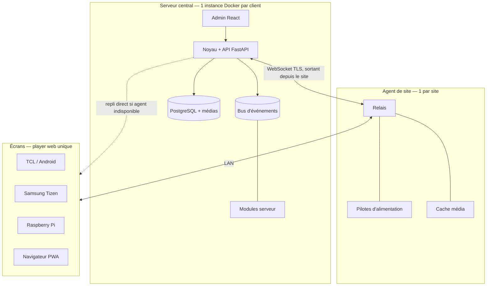

# VDS — Architecture

## Contraintes

| Contrainte | Valeur | Effet |
| --- | --- | --- |
| Déploiement | Autonome (une instance Docker par client) OU hébergé dans le Studio Allia (Dokploy, `/espace/affichage`) | Même code ; le mode = un préréglage de modules |
| Multi-locataire | Plusieurs sites par instance, un client par instance | Pas de multi-locataire |
| Volume | 4 sites à 1 an, illimité ensuite | Installation et mise à jour en une commande |
| Équipe | 1 développeur | Peu de pièces mobiles |
| Matériel | TCL Google TV 2023, Samsung Tizen grand public 2023, Raspberry Pi, navigateurs | Un player web, 4 empaquetages |
| Exposition | Écrans accessibles au public | Kiosque obligatoire |
| Réseaux | Agent local autorisé sur chaque site | Un agent par site |
| Hors service | Ex. 18h30 → 8h30 | Autonomie hors ligne ≥ 1 journée |

## Vue d'ensemble



## Deux modes de déploiement

| | Autonome | Hébergé Studio Allia |
| --- | --- | --- |
| Lancement | `docker compose up` | Application Dokploy `vds` (VPS 1), image construite en CI |
| `VDS_BASE_PATH` | `/` | `/espace/affichage` |
| `VDS_AUTH_PROVIDER` | `auth.local` | `auth.studio-allia` |
| `VDS_THEME` | `theme.vtech` | `theme.allia` |
| Base | PostgreSQL de l'instance | `vds-db` (postgres:17), séparée de `espace-db` |

Détail complet : `docs/integration-studio-allia.md`.

Conséquences techniques :
- **Chemin de base partout** : routes FastAPI montées sous `VDS_BASE_PATH`, admin React construite avec une base relative et une config d'exécution (`<base>/config.js` servi par le serveur), WebSocket et médias sous le même préfixe.
- **Auth abstraite dès le lot 1** : l'interface `auth-provider` n'est plus un module futur, elle porte `auth.local` et `auth.studio-allia`. SSO génériques (LDAP, M365, Google) restent futurs.
- **Thème = module** (`kind: theme`) : jeu de tokens CSS, polices, logo, ton éditorial. L'admin et les écrans système du player chargent le thème actif.

## Noyau

Responsabilités :
- API REST + WebSocket (OpenAPI générée)
- Registre des modules : chargement, versions, dépendances, état, quarantaine
- Bus d'événements interne (pub/sub typé, persistant pour les événements critiques)
- Résolution de la configuration héritée + provenance
- Utilisateurs, rôles (admin, éditeur), pipeline d'authentification délégué au module `auth-provider` actif (la connexion locale est le module `auth.local`, pas du code noyau — décision lot 1), groupes, validation avant diffusion
- Planification et résolution de la diffusion par écran

Version du noyau = version du contrat de module : **`vds-core 1.0.0`** au lot 1 (`vds_sdk.CORE_API_VERSION`). Toute évolution du contrat = bump + note de compatibilité dans `docs/roadmap.md` › Décisions.

## Monorepo (décision lot 1)

Un dépôt, deux espaces de travail : **uv workspace** (Python 3.12) à la racine et **pnpm workspace** (Node 22 LTS, pnpm via corepack, champ `packageManager`).

```
Makefile                  # dev test lint e2e api-types migrate i18n-check fmt
pyproject.toml            # [tool.uv.workspace] members = apps/server, apps/site-agent, packages/sdk-py ; config ruff + mypy (strict) + pytest
uv.lock  .python-version  # 3.12
package.json  pnpm-workspace.yaml  pnpm-lock.yaml  tsconfig.base.json
.env.example              # toutes les variables VDS_*, aucune valeur secrète
apps/server/              # paquet vds_server
  pyproject.toml  alembic.ini
  src/vds_server/
    main.py               # create_app(settings) -> ASGI app (montée sous VDS_BASE_PATH)
    settings.py           # pydantic-settings, préfixe VDS_
    http/                 # base_path.py, security_headers.py, same_origin.py, spa.py (admin + player + config.js)
    db/                   # base.py, session.py (asyncpg), models/
    core/                 # registry.py, bus.py, outbox.py, config_resolver.py, auth.py, audit.py
    api/v1/               # health, me, auth, sites, groups, screens, config, modules
  migrations/             # env.py + versions/0001_socle.py (branche "core")
  tests/
apps/site-agent/          # paquet vds_agent : squelette seul au lot 1 (pyproject + __main__), code au lot 3
apps/admin/               # React 18 + Vite, base "./" ; eslint.config.js (la config ESLint vit ici, pas à la racine) ; src/runtime-config.ts, src/theme/, src/i18n/{fr,en}.json
apps/player/              # squelette Vite au lot 1 (servi sous <base>/player/), code au lot 2
packages/sdk-py/          # paquet vds_sdk : contrat de module (voir plus bas)
packages/sdk-ts/          # api.gen.ts (openapi-typescript), runtime-config.ts, content-type.ts (interface, lot 2)
modules/<id>/             # format du skill vds-module ; au lot 1 : auth.local, theme.vtech, theme.allia
                          # (auth.studio-allia au lot 4 bis). Les modules ne sont PAS des membres du workspace :
                          # le noyau les charge par chemin ; leurs dépendances Python vivent dans apps/server.
docker/
  server.Dockerfile       # multi-étapes : pnpm build admin + player -> image Python unique (API + statiques)
  site-agent.Dockerfile
  compose.yaml            # postgres:17 + server (mode autonome, VDS_BASE_PATH=/)
  compose.dev.yaml        # surcharges dev (rechargement, vite)
  compose.subpath.yaml    # surcharge VDS_BASE_PATH=/espace/affichage pour les tests
deploy/dokploy/README.md  # application vds, variables, routage, sauvegardes — sans secret
.github/workflows/
  ci.yml                  # lint + test (matrice VDS_BASE_PATH = / et /espace/affichage) + e2e
  images.yml              # build + push vds-server et vds-site-agent (registre : question ouverte, GHCR proposé)
```

- **Une seule image serveur** (API + admin + player statiques, un port) : colle à l'application Dokploy unique `vds` et à `docker compose up`. Pas de nginx séparé.
- Tests serveur sur un **vrai PostgreSQL 17** (service compose `db-test`) : le schéma utilise jsonb, colonnes générées, citext. Pas de SQLite.
- `make api-types` : export OpenAPI (`python -m vds_server.openapi`) → `openapi-typescript` → `packages/sdk-ts/src/api.gen.ts`, versionné ; la CI échoue si le fichier diffère.
- `make test` = pytest (deux valeurs de `VDS_BASE_PATH`) + vitest + `pnpm i18n:check`.

## Contrat de module

Manifeste (`module.json`), schéma de validation livré dans `packages/sdk-py/src/vds_sdk/schemas/module.schema.json` (JSON Schema 2020-12) :

```json
{
  "id": "power.samsung-ws",
  "version": "1.2.0",
  "core": ">=1.0 <2.0",
  "kind": "power-driver",
  "name": { "fr": "...", "en": "..." },
  "description": { "fr": "...", "en": "..." },
  "targets": ["server", "site-agent"],
  "entrypoints": { "server": "server.module:SamsungWsDriver", "site-agent": "agent.module:SamsungWsDriver" },
  "requires": {},
  "capabilities": ["power.on", "power.off", "power.state"],
  "permissions": ["lan.access", "screens.read"],
  "events": { "listens": ["power.requested"], "emits": ["power.changed"] },
  "config": { "$ref": "config.schema.json" },
  "assets": "assets",
  "i18n": ["fr", "en"],
  "author": "V-Tech",
  "signature": null
}
```

Champs (contrat 1.0) :

| Champ | Règle |
| --- | --- |
| `id` | `^[a-z][a-z0-9]*\.[a-z0-9][a-z0-9-]*$` (`<kind-court>.<nom>`), immuable |
| `version`, `core` | semver ; `core` = intervalle de `vds-core` compatible, vérifié au chargement |
| `kind` | `player-adapter` · `power-driver` · `content-type` · `trigger` · `notifier` · `auth-provider` · `theme` · `storage` (liste fermée en 1.x) |
| `targets` | sous-ensemble de `server`, `site-agent`, `admin`, `player` |
| `entrypoints` | `"<chemin.module.python>:<Classe>"` relatif au dossier du module, par cible Python ; absent pour un module déclaratif (`theme`) |
| `requires` | `{ "<id>": "<intervalle semver>" }` : ordre d'activation uniquement, jamais d'appel direct |
| `events.listens` / `events.emits` | noms `domaine.verbe_passé`, suffixe optionnel `@N` (version de payload, défaut 1). Le noyau refuse à l'exécution toute publication ou abonnement non déclaré |
| `permissions` | catalogue fermé ci-dessous ; refus à l'exécution hors déclaration |
| `assets` | dossier servi en lecture seule sous `<base>/modules/<id>/assets/` |
| `theme` | obligatoire si `kind = theme` : `{ "css": "assets/tokens.css", "fonts": [...], "logo": {"light": "...", "dark": "..."}, "icons": "material-symbols" \| "lucide", "color_schemes": ["light","dark"] }` |
| `signature` | `null` pour les modules intégrés ; tiers non signés bloqués par défaut |

Schéma de config (`config.schema.json`, JSON Schema 2020-12, `type: object`, `additionalProperties: false`). Chaque propriété de premier niveau porte obligatoirement `title`, `description` (clés i18n), `default` (sauf si listée dans `required`) et `x-vds-level: "simple" | "advanced"`. Extensions optionnelles :
- `x-vds-scopes` : niveaux autorisés à surcharger (`organization`, `site`, `group`, `screen`) ; défaut : les quatre.
- `x-vds-env` : nom d'une variable d'environnement qui fournit la valeur (ex. `STUDIO_SESSION_URL`) ; la clé devient non modifiable par l'API.
- `x-vds-secret: true` : jamais renvoyée par l'API HTTP ni journalisée (implique `x-vds-env`). L'API renvoie `value: null` + `is_set: bool` + provenance `env`. Le **module propriétaire** la reçoit via `ctx.config.resolve()` sous forme de `pydantic.SecretStr` (lecture par `get_secret_value()`, `repr` masqué) ; aucun autre module n'y a accès.
- `x-vds-groups` (racine) : regroupement des champs dans le formulaire.

Permissions (catalogue 1.0) : `screens.read`, `screens.write`, `sites.read`, `config.read.core`, `users.read`, `media.read`, `media.write`, `lan.access`, `net.outbound`, `fs.media`, `http.routes`, `db.own-tables`, `users.provision`. `users.provision` (façade `ctx.core.users.provision(identity: Identity, *, role: Literal["admin","editor"] | None = None) -> UserRef`, upsert par `(provider, external_id)`) n'est acceptée que si `kind = "auth-provider"` : le registre rejette tout autre manifeste qui la déclare. Un module lit toujours sa propre config. En processus (modules intégrés), les permissions sont appliquées par la façade `CoreApi` ; l'isolation forte ne concerne que les modules tiers (processus séparé).

Interfaces Python (`vds_sdk`, sans dépendance FastAPI ; les kinds serveur sont dans `vds_sdk.server`) :

```python
CORE_API_VERSION = "1.0.0"


class ModuleContext(Protocol):
    module_id: str
    bus: ScopedBus  # filtré par events.listens/emits
    config: ConfigReader  # async resolve(scope: ScopeRef | None = None) -> dict[str, Any]
    core: CoreApi  # façade filtrée par permissions
    log: logging.Logger

    def t(self, key: str, locale: str, **params: Any) -> str: ...


class Module(ABC):
    async def setup(self, ctx: ModuleContext) -> None: ...
    async def teardown(self) -> None: ...
    async def health(self) -> Health: ...  # défaut : ok
    def routes(
        self,
    ) -> "APIRouter | None": ...  # permission http.routes ; monté sous <base>/api/v1/m/<id>/


class Identity(BaseModel):  # renvoyé par un auth-provider
    provider: str
    external_id: str
    email: str | None
    display_name: str
    role: Literal["admin", "editor"] | None  # None = rôle géré dans VDS (auth.local)


class AuthProvider(Module):
    async def authenticate(
        self, request: AuthRequest
    ) -> Identity | None: ...  # lève AccessDenied(code) pour refuser (ex. financeur)
    def login_url(self, return_to: str) -> str: ...
    def logout_url(self) -> str: ...
    def shell_links(self) -> list[ShellLink]: ...  # ex. « Retour au Studio » ; défaut []
```

Le noyau transforme l'`Identity` en `Principal` (upsert `user_account` par `(provider, external_id)`), puis applique rôles et contrôle de même origine. Rôles V1 : `admin` (écriture) et `editor` (lecture du parc et de la config, contenus) ; pas de lecteur (ajout futur = valeur `CHECK` additive + bump mineur). Un `Identity.role` non `None` fait foi à chaque connexion ; un auth-provider qui reçoit un rôle externe inconnu lève `AccessDenied("role_unmapped")` (refus par défaut). La validation avant diffusion est un droit par groupe, pas un rôle. Limitation de débit des connexions : responsabilité du module auth qui porte le formulaire (`auth.local` : table `m_auth_local_login_attempt`, 5 échecs / 15 min par identifiant normalisé et 20 / 15 min par IP, 429 `errors.auth.too_many_attempts` + `Retry-After`) ; le noyau fournit seulement `ctx.core.http.client_ip(request) -> str`, résolue avec la même règle de proxy de confiance que le contrôle de même origine. Un seul auth-provider actif (`VDS_AUTH_PROVIDER`), un seul thème actif (`VDS_THEME`). Le kind `theme` est **déclaratif** (manifeste + assets, aucun code). Les classes de base des autres kinds (`PowerDriver`, `Notifier`, `Trigger`, `Storage`, `PlayerAdapter`, et `ContentType` côté `sdk-ts`) sont ajoutées dans leur lot ; la liste des kinds est déjà figée.

Bus d'événements :

```python
class Event(BaseModel):  # payload ; une classe par (nom, version)
    name: ClassVar[str]  # "config.changed"
    version: ClassVar[int] = 1
    critical: ClassVar[bool] = False  # True -> persisté (outbox) et livré au moins une fois


class Envelope(BaseModel):
    id: UUID
    name: str
    version: int
    occurred_at: datetime
    source: str  # "core" ou id de module
    origin: str = "server"  # point d'accroche du pont agent (lot 3) : "agent:<site_id>"
    correlation_id: UUID | None
    payload: dict[str, Any]


class ScopedBus(Protocol):
    async def publish(self, event: Event, *, correlation_id: UUID | None = None) -> UUID: ...
    def subscribe(
        self, event_type: type[Event], handler: Callable[[Envelope], Awaitable[None]]
    ) -> None: ...
```

- Événements des domaines partagés (`core`, `module`, `config`, `screen`, `site`, `power`, `content`, `alert`…) : modèles Pydantic dans `vds_sdk.events`, exportés en JSON Schema. Un module ne crée de nouveaux noms que sous son propre id.
- Payload : ajout de champ optionnel = même version ; tout autre changement = version N+1, les deux publiées pendant la transition.
- Abonnés idempotents (clé = `Envelope.id`). Échecs d'un abonné : 5 en 10 min (réglage `core`) → module en quarantaine + `module.quarantined`.
- Événements noyau du lot 1 : `module.enabled`, `module.disabled`, `module.quarantined` (critique), `config.changed`, `site.created|updated|deleted`, `group.*`, `screen.*` (mêmes verbes), `user.created`.

Cycle de vie (lot 1) : au démarrage, le registre découvre `modules/*/module.json`, valide manifeste + schéma de config + compatibilité `core`, synchronise la table `module`, active les modules requis (`VDS_AUTH_PROVIDER`, `VDS_THEME`) puis les autres activés en base. Activer / désactiver / quarantaine fonctionnent à chaud. Installation d'archive, mise à jour et rollback : même format, livrés plus tard (risque « modularité trop lourde »).

Tables propres à un module intégré (permission `db.own-tables`) : préfixe `m_<id avec . et - remplacés par _>_` (ex. `m_auth_local_session`), migrations dans `modules/<id>/server/migrations/`, branche Alembic = id du module, clés étrangères autorisées **uniquement** vers les tables du noyau. Les modules tiers n'ont pas d'accès base.

- L'admin génère les formulaires depuis le schéma de config (`x-vds-level` décide simple / avancé).
- Cycle de vie cible : installer → valider permissions → activer → mettre à jour → rollback → désactiver, sans redémarrage. Échecs répétés → quarantaine.
- Modules tiers : processus/conteneur isolé côté serveur, iframe sandbox côté player, signature (non signés bloqués par défaut), compatibilité semver vérifiée à l'installation.

## Chemin de base `VDS_BASE_PATH` (décision lot 1)

Normalisation au démarrage (`settings.py`) : `/` → `""`, sinon `^(/[a-z0-9_-]+)+$` sans `/` final (`/espace/affichage`). Toute autre valeur fait échouer le démarrage. Aucune autre variable ne dépend du mode.

| Élément | URL | Règle |
| --- | --- | --- |
| Montage | `Mount(base, app=vds_app)` | Toujours la même construction, quelle que soit la valeur ; hors du préfixe : 404. Le préfixe n'est jamais retiré par le proxy |
| API | `<base>/api/v1/...` ; modules : `<base>/api/v1/m/<id>/...` | OpenAPI et docs sous le même préfixe |

Note : les routes de module (`/api/v1/m/<id>/`) sont montées dynamiquement et ne figurent **pas** dans l'OpenAPI principale ni dans `packages/sdk-ts` (`make api-types`, `make api-types-check` en CI ; export sans DB par `scripts/export_openapi.py`).
| Santé | `<base>/health` | Moniteur Uptime Kuma |
| WebSocket | `<base>/ws/player`, `<base>/ws/agent`, `<base>/ws/admin` | Players et agents stockent l'**URL complète du serveur, préfixe compris**, et y ajoutent des chemins relatifs |
| Admin | `<base>/` (repli SPA sur `index.html` hors `api/ws/media/modules/player/health`) | Vite `base: "./"` ; le serveur injecte `<base href="<base>/">` dans `index.html` au démarrage ; React Router `basename` lu dans la config d'exécution |
| Config d'exécution | `<base>/config.js` (no-store) | `window.__VDS__ = { basePath, apiBase, wsBase, defaultLocale, version, theme: {id, cssUrl, icons, logo}, auth: {provider, loginUrl, logoutUrl, links} }` — fichier, pas de script en ligne (CSP) |
| Player | `<base>/player/` | Service Worker de portée `<base>/player/` |
| Médias | `<base>/media/<media_id>/<variant>` | La base ne stocke **que des clés relatives**, jamais d'URL absolue ; les URL sont construites par `url_for` / `settings.url()` |
| Assets de module | `<base>/modules/<id>/assets/...` | Thèmes, web components |
| Cookies | `Path=<base>/` (ou `/`), `HttpOnly; Secure; SameSite=Lax` | Posés uniquement par le module auth actif via `ctx.core.http.cookie_path()` |
| Redirections | `settings.url("/...")` | Paramètre `return_to` accepté seulement s'il est un chemin commençant par `<base>/` (pas de `//`, pas de schéma) ; l'URL de connexion vient de `AuthProvider.login_url()` |

- **Contrôle de même origine** (les deux modes) : toute méthode non sûre sous `<base>/api/` sans `Authorization: Bearer` exige `Sec-Fetch-Site: same-origin` ou un `Origin` égal à `VDS_PUBLIC_ORIGIN` (à défaut, l'origine reconstruite derrière proxy de confiance). Sinon 403 `errors.origin_mismatch`.
- **En-têtes** (les deux modes, aucune branche) : `X-Robots-Tag: noindex`, `X-Frame-Options: DENY`, `Cache-Control: private, no-store` sur tout le préfixe ; le player et l'agent font leur propre cache.
- Ce qui varie selon le déploiement passe par : `VDS_BASE_PATH`, `VDS_AUTH_PROVIDER`, `VDS_THEME`, `VDS_DEFAULT_LOCALE`, `VDS_PUBLIC_ORIGIN`, et les clés `x-vds-env` des modules (`STUDIO_SESSION_URL`, `STUDIO_SHARED_SECRET` appartiennent à `auth.studio-allia` ; `VDS_ADMIN_EMAIL`, `VDS_ADMIN_PASSWORD` appartiennent à `auth.local` : premier admin créé au démarrage si aucun compte n'existe, sans jeton d'amorçage). Autres variables : `VDS_DATABASE_URL`, `VDS_SECRET_KEY`, `VDS_MEDIA_DIR`, `VDS_MODULES_DIR`.
- Tests : fixture pytest paramétrée sur `/` et `/espace/affichage` pour toute la suite API ; Playwright lancé sur les deux (surcharge `docker/compose.subpath.yaml`) ; matrice CI.

## Modèle de données initial (migration `0001_socle`, PostgreSQL 17)

Conventions : clés `uuid` par `gen_random_uuid()`, horodatages `timestamptz`, `created_at`/`updated_at` partout, extension `citext`, énumérations en `text` + `CHECK` (plus simples à étendre de façon additive qu'un `ENUM`), migrations additives.

| Table | Colonnes clés | Contraintes / index |
| --- | --- | --- |
| `organization` | id, name, singleton bool | `singleton` `UNIQUE` + `CHECK (singleton)` : une seule ligne (un client par instance) |
| `site` | id, organization_id, name, slug, archived_at | FK organization ; `UNIQUE (slug)` |
| `screen_group` | id, site_id, name | FK site `ON DELETE RESTRICT` ; `UNIQUE (site_id, name)` ; `UNIQUE (id, site_id)` (cible de FK composite) |
| `screen` | id, site_id, group_id null, name, orientation (`landscape`/`portrait`), archived_at | FK site ; FK composite `(group_id, site_id) → screen_group(id, site_id)` : le groupe est forcément du même site ; index `(site_id)`, `(group_id)` |
| `user_account` | id, auth_provider, external_id, email citext null, display_name, role (`admin`/`editor`), locale null, is_active, last_seen_at | `UNIQUE (auth_provider, external_id)` ; index `(email)` non unique |
| `config_override` | id, organization_id / site_id / group_id / screen_id (nullables), scope_level (généré : 0 org, 1 site, 2 groupe, 3 écran), scope_id (généré : `COALESCE(screen_id, group_id, site_id, organization_id)`), namespace, key, value jsonb, updated_by | `CHECK (num_nonnulls(organization_id, site_id, group_id, screen_id) = 1)` ; FK `ON DELETE CASCADE` ; `UNIQUE (scope_id, namespace, key)` ; index `(namespace, key)` (« qui surcharge X ? ») |
| `module` | id text PK, version, kind, source (`builtin`/`installed`), state (`discovered`/`enabled`/`disabled`/`quarantined`/`incompatible`), manifest jsonb, config_schema jsonb, checksum, failure_count, last_error, state_changed_at | `CHECK` sur kind et state |
| `event_outbox` | id uuid, name, version, source, origin, correlation_id, payload jsonb, occurred_at | index `(occurred_at)` ; uniquement les événements `critical` |
| `event_delivery` | event_id, subscriber, status (`pending`/`done`/`failed`), attempts, next_attempt_at, last_error | PK `(event_id, subscriber)` ; index partiel `(next_attempt_at) WHERE status = 'pending'` |
| `audit_log` | id bigserial, occurred_at, actor_kind (`user`/`module`/`system`/`device`), actor_id, action, target_type, target_id, details jsonb | index `(target_type, target_id)`, `(occurred_at)` |

Module `auth.local` (branche Alembic `auth.local`) : `m_auth_local_credential(user_id PK→user_account, password_hash argon2id, must_change)`, `m_auth_local_session(id, user_id, token_hash UNIQUE, expires_at, revoked_at, last_seen_at)`.

Ajouts prévus (additifs, lots suivants) : `tag` + `screen_tag` (ciblage transversal, lot 2), jetons d'appareil (lot 2), `site_agent` (lot 3), groupes d'utilisateurs / validation (lot 4). Points d'accroche réservés : position dans un mur (colonnes futures sur `screen`), `conditions` sur `schedule`, clés d'API (`Authorization: Bearer` déjà exempté du contrôle d'origine).

## Configuration héritée — résolution

- **Espaces de noms** : `core` (schéma livré par le serveur : `timezone` défaut `Europe/Paris`, `locale`, réglages de quarantaine…) et un par module (son `config.schema.json`). Les variables d'environnement de déploiement ne sont jamais en base.
- **Granularité** : clé de premier niveau. Objets et tableaux sont remplacés en bloc (pas de fusion profonde).
- **Algorithme** `resolve(namespace, target)` : chaîne `[organisation, site, groupe?, écran]` de la cible ; une requête `WHERE namespace = :ns AND scope_id = ANY(:chain)` ; on part des `default` du schéma (provenance `default`), puis on applique les surcharges par `scope_level` croissant ; les clés `x-vds-env` sont lues dans l'environnement (provenance `env`). Une valeur stockée devenue invalide pour le schéma courant est ignorée et signalée (`warnings`).
- **Écriture** : refusée si le niveau n'est pas dans `x-vds-scopes` ou si la valeur ne valide pas ; publie `config.changed {namespace, keys, scope_level, scope_id}` qui invalide le cache mémoire du résolveur.
- **API** :
  - `GET <base>/api/v1/config/{level}/{id}/{namespace}` → `{ "values": { "<clé>": { "value": …, "origin": { "level": "site", "id": "…", "name": "Moulins" } | { "level": "default" } | { "level": "env" }, "inherited": …, "overridable": true } }, "warnings": [] }` (`inherited` = valeur sans la surcharge de ce niveau, pour « revenir à l'héritage »).
  - `PUT …/{namespace}/{key}` `{ "value": … }` ; `DELETE …/{namespace}/{key}` = revenir à l'héritage.

| kind | Rôle | V1 |
| --- | --- | --- |
| player-adapter | Installation, capture, redémarrage, kiosque | Android, Tizen, Chromium Pi |
| power-driver | Allumer / éteindre / lire l'état | ADB, Samsung WS, WoL, CEC, écran noir |
| content-type | Rendu d'un contenu (web component) | image, vidéo, PDF, URL, météo, RSS |
| trigger | Source d'événements | planning |
| notifier | Notifications | mail |
| auth-provider | Identité | local, studio-allia |
| theme | Tokens, polices, logo, ton | vtech, allia |
| storage | Médias | disque local |

## Players

| Plateforme | Empaquetage | Kiosque | Pilotage local |
| --- | --- | --- | --- |
| TCL Google TV | App Android (WebView) sur la TV | Device Owner / épinglage, boot | ADB réseau, CEC |
| Clé Android TV | Même app | Idem | ADB, CEC selon modèle |
| Samsung Tizen | App web Tizen (mode dev) ou boîtier HDMI | Lancement auto, touches neutralisées | API WebSocket Samsung, WoL |
| Raspberry Pi | Chromium kiosque, image dédiée | Pas de bureau | CEC (libcec) |
| Navigateur | PWA plein écran | Limité | WoL, veille OS |

Player : appairage par code, sync WebSocket (repli polling), cache journée + lendemain, lecture hors ligne (rallumage inclus), remontée d'état, captures à la demande, watchdog. Kiosque : pas de sortie, reprise après coupure, télécommande/USB neutralisés si possible, déverrouillage maintenance par code depuis l'admin.

## Alimentation — pilotes en cascade

Exécutés sur l'agent de site. Ordre par défaut, modifiable par écran :

| # | Pilote | On | Off | État | V1 |
| --- | --- | --- | --- | --- | --- |
| 1 | API constructeur (Samsung WS, ADB) | partiel | oui | oui | oui |
| 2 | Wake-on-LAN | oui | non | non | oui |
| 3 | HDMI-CEC via player | oui | oui | oui | oui |
| 4 | Cloud constructeur | oui | oui | oui | futur |
| 5 | Infrarouge | oui | oui | non | futur |
| 6 | Prise connectée | oui | oui | oui | futur |
| 7 | Écran noir | simulé | simulé | oui | toujours |

Règles : assistant de détection à l'ajout ; vérification après chaque ordre, retry puis pilote suivant ; CEC Active Source au rallumage ; gestion veille auto TV / « aucun signal » / mauvaise entrée. Planning : plages par jour, exceptions (fériés, vacances scolaires par zone, fermetures). Supervision : `scheduled_off` ≠ `offline`, aucune alerte en plage prévue.

## Contenus et diffusion

| Objet | Contenu |
| --- | --- |
| Media | image, vidéo ≤ 4K (son on/off), PDF → pages, URL |
| Widget | météo, RSS (content-type) |
| Layout | grille de zones + calques (bandeau, logo, horloge) ; paysage et portrait |
| Playlist | éléments + durées + transitions, affectée à une zone |
| Schedule | layout + playlists + créneau + cible (site/groupe/tag/écran) |
| Override | layout prioritaire sur un créneau |

Résolution par écran : override actif > alternance des schedules actifs > hors plage = éteint (ou écran noir). Le serveur calcule ; le player reçoit le résultat pour J et J+1.

## Données, sécurité, déploiement

- PostgreSQL 17 ; médias disque local via module storage ; cache média sur l'agent.
- Migrations Alembic **additives** (pas de suppression ni de renommage d'une colonne lue en production), comme la règle du Studio.
- Images Docker construites en CI (GitHub Actions) et publiées dans un registre ; jamais de build sur le serveur de production.
- Rôles admin/éditeur, groupes, validation configurable ; appairage par code à usage unique puis jeton par écran révocable ; journal d'audit ; sauvegarde documentée.
- `docker compose up` + assistant de premier lancement ; mise à jour en un clic, migrations auto ; déploiement progressif players/agents (groupe test puis parc).
- Notifications mail : écran hors ligne hors plage prévue, pilote en échec, module en quarantaine.

## Points d'accroche des modules futurs

| Module | Ce que le noyau prévoit en V1 |
| --- | --- |
| Alertes prioritaires | Priorité de diffusion au-dessus de l'override, rallumage forcé, événement `alert.raised` |
| SSO / LDAP / M365 / Google | Interface auth-provider déjà en place (local + studio-allia) |
| Diffusion conditionnelle | Champ `conditions` évaluable sur un schedule |
| Tactile / interactif | Événements d'entrée remontés par le player |
| Murs d'écrans | Horloge commune, position d'un écran dans un mur |
| Statistiques | Journal de lecture remonté par le player |
| API publique | Clés d'accès + scopes |
| Catalogue | Signature et métadonnées dans le manifeste |
