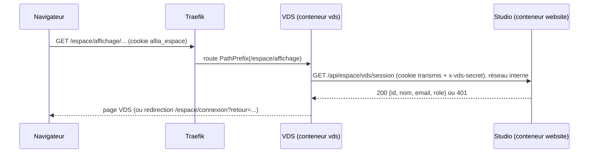

# VDS — Intégration au Studio Allia

VDS se lance de deux façons, **avec le même code** :

| | Mode autonome | Mode hébergé Studio Allia |
| --- | --- | --- |
| Lancement | `docker compose up` chez le client | Application Dokploy `vds` dans le projet « Allia Innovation » (VPS 1) |
| Adresse admin | `https://<domaine-client>/` | `https://allia-innovation.fr/espace/affichage/` |
| Connexion | Module `auth.local` (comptes VDS) | Module `auth.studio-allia` (session du Studio, connexion unique) |
| Rôles | Admin / éditeur gérés dans VDS | Déduits du rôle Studio (voir plus bas) |
| Thème | `theme.vtech` (charte V-Tech) | `theme.allia` (charte Allia) |
| Langue | FR / EN | FR (EN disponible) |
| Base | PostgreSQL de l'instance | Service Dokploy `vds-db` (postgres:17), séparé de `espace-db` |

**Principe** : le mode hébergé n'est pas une branche du code, c'est un **préréglage de modules** (auth-provider + theme + chemin de base). Aucun `if (studio)` dans le noyau.

```
VDS_BASE_PATH=/espace/affichage
VDS_AUTH_PROVIDER=auth.studio-allia
VDS_THEME=theme.allia
VDS_DEFAULT_LOCALE=fr
STUDIO_SESSION_URL=http://<service-website-interne>/api/espace/vds/session
STUDIO_SHARED_SECRET=<secret Dokploy>
```

## Ce qui ne change pas

- VDS garde **sa propre base**. Il ne lit ni n'écrit jamais `espace-db` : les données du Studio (diagnostics, contacts, Rebond, frais) restent hors de portée de VDS, conformément à la règle « la base décide des droits » du Studio.
- Players et agents de site fonctionnent à l'identique dans les deux modes (jetons d'appareil, pas de cookie).

## Connexion unique (`auth.studio-allia`)



- VDS ne lit jamais le cookie lui-même : il le **transmet** au Studio, qui reste seul juge de la session.
- Réponse mise en cache 60 s maximum par empreinte de cookie ; jamais le cookie en clair dans les logs.
- Déconnexion : lien vers la déconnexion du Studio.
- Écritures authentifiées par cookie → **contrôle de même origine** (en-têtes `Origin` / `Sec-Fetch-Site`) sur toute requête d'écriture, comme `lib/server/espace/origine.ts` du Studio.

### Correspondance des rôles

| Rôle Studio | Rôle VDS |
| --- | --- |
| `president` | admin |
| `direction` | admin |
| `membre` | éditeur |
| `financeur` | aucun accès (403, entrée de menu masquée) |
| compte inactif / mot de passe provisoire | aucun accès, renvoi vers le Studio |

Le premier accès d'un utilisateur Studio crée son profil VDS (identifiant Studio en référence, pas de mot de passe stocké). Les groupes VDS et la validation avant diffusion se règlent ensuite dans VDS.

## Ce qu'il faut ajouter côté Studio

À faire dans le dépôt du Studio, en suivant son guide « 04 — Ajouter un module ». **Aucune migration** n'est nécessaire.

1. **Route** `app/api/espace/vds/session/route.ts` (GET) :
   - refuse si l'en-tête `x-vds-secret` ne correspond pas à `VDS_STUDIO_SECRET` ;
   - `sessionOuNull()` ; 401 si absente, inactive ou mot de passe provisoire ;
   - renvoie `{ id, nom, email, role }` uniquement, `Cache-Control: private, no-store`.
2. **Menu** `components/espace/Nav.tsx`, tableau `LIENS` :
   `{ href: "/espace/affichage", label: "Affichage", Icon: MonitorPlay, roles: ["president", "direction", "membre"] }`.
   La route n'étant pas une page Next, vérifier que le lien fait une navigation complète (balise `<a>`), pas une navigation client.
3. **Variable** `VDS_STUDIO_SECRET` dans Dokploy → `website` → Environment (même valeur que `STUDIO_SHARED_SECRET` côté `vds`).
4. **Doc** : une ligne « Affichage » dans `docs/05-modules-existants.md` du Studio.

À vérifier : le cookie `allia_espace` doit être posé avec `path=/` pour être envoyé sur `/espace/affichage`.

## Routage et déploiement Dokploy

- Application `vds` dans le projet « Allia Innovation », domaine `allia-innovation.fr`, **chemin `/espace/affichage`**, port du conteneur VDS. Traefik donne la priorité au chemin le plus long : le reste du site continue d'aller vers `website`.
- Le préfixe n'est **pas** retiré : VDS sert tout sous `VDS_BASE_PATH` (admin, API, WebSocket, fichiers).
- Base `vds-db` (postgres:17), sans port externe ; volume `vds-media`.
- Sauvegardes sur le modèle du Studio : base tous les jours (30 copies), volume média tous les jours (14 copies), vers le MinIO de VPS 2.
- **Image construite hors du VPS** (GitHub Actions → registre d'images), puis déployée par Dokploy. Le Studio a déjà vu un build faire tomber VPS 1 (incident du 2026-10-06).
- Surveillance : Uptime Kuma (moniteur sur `/espace/affichage/health`), notifications Discord « Deploys ».

## Règles du Studio que VDS respecte en mode hébergé

- `noindex` + `X-Robots-Tag`, `Cache-Control: private, no-store`, `X-Frame-Options: DENY` sur tout `/espace/affichage`.
- Utilisable au téléphone : 375 px de large, cibles de 44 px minimum.
- Ton Allia : vouvoiement, phrases courtes, pas d'emoji, dates absolues.
- Logos officiels uniquement (`public/brand/*.svg` du Studio), jamais redessinés ni recolorés.
- Migrations **additives** (pas de pré-production : tout push sur `main` part en production).
- Aucune donnée réelle ni secret dans le dépôt ou l'image.

## Charte Allia (thème `theme.allia`)

| Variable Studio | Valeur | Rôle VDS |
| --- | --- | --- |
| `--vif` | `#0e49be` | primary |
| `--marine` | `#1d314b` | secondary, titres |
| `--rose-t` | `#a8336a` | tertiary (accent : forçage) |
| `--ciel` | `#ace0fc` | surface d'accent claire |
| `--rose` | `#f5a5c6` | surface d'accent secondaire |

Polices : Bricolage Grotesque (titres), Manrope (texte), JetBrains Mono (données techniques), auto-hébergées. Mode sombre et couleurs d'état : non définis par la charte Allia, à valider.
